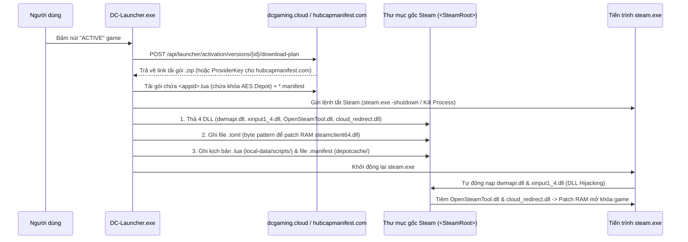
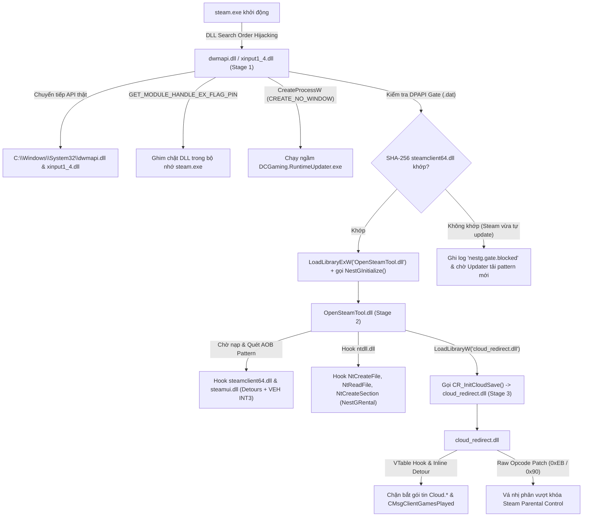

# Báo Cáo Phân Tích Ngược Kỹ Thuật: DCGamingLauncher & Các DLL Tiêm Vào Steam

Tài liệu này tổng hợp phân tích dịch ngược chi tiết (Reverse Engineering Report) về kiến trúc, cơ chế hoạt động, các hành vi can thiệp hệ thống và vi phạm bản quyền của **DCGamingLauncher** cùng bộ **04 tệp DLL native x64** được cài đặt vào thư mục gốc của Steam.

Tài liệu được phân tách rõ ràng thành 2 phần:
- [Phần 1: Báo Cáo Phân Tích Hành Vi Của Launcher](#phần-1-báo-cáo-phân-tích-hành-vi-của-launcher)
- [Phần 2: Báo Cáo Phân Tích Ngược Bộ 04 Tệp DLL Tiêm Vào Steam](#phần-2-báo-cáo-phân-tích-ngược-bộ-04-tệp-dll-tiêm-vào-steam)

---

# PHẦN 1: BÁO CÁO PHÂN TÍCH HÀNH VI CỦA LAUNCHER

# Báo Cáo Phân Tích Ngược (Reverse Engineering) & Các Hành Vi Trái Phép Của DCGamingLauncher

> **Đối tượng phân tích:** `DCGamingLauncher` (`DC-Launcher.exe` v1.0.29 / Runtime Bundle `bettersteamtools-cloud` v1.0.19)  
> **Đường dẫn cài đặt:** `C:\Users\baoba\AppData\Local\Programs\DCGamingLauncher`  
> **Nền tảng:** .NET 8.0 Single-File Executable (Avalonia UI) + Go Helper (`DCGaming.SteamDpi.Helper.exe`) + Native C++ x64 Payload DLLs

---

## 1. Tóm Tắt Điều Hành (Executive Summary)

Qua quá trình unpack .NET Single-File Bundle (`DC-Launcher.exe`, `DCGaming.Launcher.UpdateHost.exe`) và trích xuất các phân hệ thực thi (`DC-Launcher.dll`, `DC-Runtime.Core.dll`, `DCGaming.RuntimeUpdater.dll`, `DCGaming.Launcher.UpdateCore.dll`) cùng kho lưu trữ `RuntimeCache`, báo cáo này xác nhận **`DCGamingLauncher` là một hệ thống thương mại hóa hành vi bẻ khóa bản quyền Steam (Commercialized Steam Piracy / Depot Unlocking), can thiệp bộ nhớ tiến trình `steam.exe` (DLL Hijacking & Memory Hooking), cài đặt tiến trình chạy ngầm dai dẳng (Persistence) và can thiệp gói tin mạng ở mức Kernel (WinDivert)**.

Các nhóm hành vi vi phạm pháp lý, điều khoản dịch vụ (Steam Subscriber Agreement - SSA) và an toàn hệ thống bao gồm:

1. **Bán & Kích hoạt trái phép game bản quyền Steam ("ACTIVE Game"):** Người dùng trả tiền trên nền tảng `dcgaming.cloud` nhưng không nhận được bản quyền (license) hợp lệ từ Valve. Thay vào đó, nút **"ACTIVE"** tải về các tệp kịch bản `.lua` chứa **khóa giải mã Depot (32-byte AES Decryption Keys)** bị đánh cắp và các tệp `.manifest` từ máy chủ lậu (`hubcapmanifest.com`, `dcgaming.cloud`), sau đó ép Steam tải và giải mã game trực tiếp từ hệ thống CDN của Valve mà không cần mua game.
2. **Tấn công DLL Hijacking vào thư mục gốc của Steam (`<SteamRoot>`):** Tự động tắt tiến trình `steam.exe` và thả **04 tệp DLL native x64 không chữ ký số** (`dwmapi.dll`, `xinput1_4.dll`, `OpenSteamTool.dll`, `cloud_redirect.dll`) vào thư mục cài đặt Steam để chiếm quyền điều khiển tiến trình `steam.exe` mỗi khi khởi động.
3. **Cài đặt cơ chế chạy ngầm (Persistence) và tự động khởi chạy tiến trình ẩn từ bên trong `steam.exe`:**
   - Tạo **Windows Scheduled Task** (`DCGamingLauncher_<User>_<Hash>`) chạy lặp lại mỗi **30 phút** vô thời hạn (`ExecutionTimeLimit = PT0S`).
   - Biến chính tiến trình `steam.exe` thành công cụ kích hoạt ngầm: mỗi khi người dùng mở Steam (kể cả khi đã tắt hoàn toàn `DC-Launcher.exe`), DLL giả mạo `dwmapi.dll`/`xinput1_4.dll` sẽ âm thầm gọi `CreateProcessW(..., CREATE_NO_WINDOW)` để chạy `%LOCALAPPDATA%\DCGamingLauncher\RuntimeUpdates\Helper\DCGaming.RuntimeUpdater.exe`.
4. **Can thiệp gói tin mạng mức Kernel (Kernel-Mode Network Tampering) & Thay đổi chính sách DNS hệ thống:** Nhúng và giải nén driver mức nhân **`WinDivert64.sys`** cùng công cụ **`winws2.exe` (Zapret2)** thông qua `DCGaming.SteamDpi.Helper.exe` (yêu cầu quyền Administrator), đồng thời chỉnh sửa bảng **Windows NRPT (Name Resolution Policy Table)** và cấu hình DNS của card mạng để chặn/chuyển hướng lưu lượng đến `*.steampowered.com` và `*.steamcommunity.com`.
5. **Trích xuất trái phép dữ liệu tài khoản Steam hợp pháp của người dùng (`ManifestDonor`):** Trong mã nguồn DLL được tiêm vào Steam (`OpenSteamTool.dll`), hệ thống âm thầm quét toàn bộ danh sách game bản quyền thật mà tài khoản Steam của người dùng đang sở hữu, tự động xin `ManifestRequestCode` từ máy chủ Valve bằng phiên đăng nhập của người dùng rồi tải lên máy chủ cộng đồng lậu (`https://manifest.luastools.xyz/manifestcode/submit`).

---

## 2. Cấu Trúc Các Thành Phần Sau Khi Unpack

Tệp thực thi chính `DC-Launcher.exe` (171 MB) thực chất là một gói .NET 8.0 Single-File Bundle chứa các assembly và tài nguyên nhúng sau:

| Thành phần | Kích thước | Vai trò kỹ thuật |
| :--- | :--- | :--- |
| `DC-Launcher.dll` | 12,554,240 bytes | Ứng dụng chính (Avalonia UI), quản lý cửa hàng, thanh toán, kích hoạt game (`SteamGameActivationService`), điều phối DLL tiêm vào Steam (`SteamClientFileProvisioner`) và tự khởi động (`LauncherAutoStartService`). |
| `DC-Runtime.Core.dll` | 90,624 bytes | Thư viện xác thực chữ ký RSA-3072 (`RuntimeReleaseVerifier`), tải gói runtime (`RuntimeReleaseClient`), giải nén kho đối tượng SHA-256 (`RuntimeCacheStore`) và tạo cổng kiểm soát DPAPI (`RuntimeGateProtector`). |
| `DCGaming.RuntimeUpdater.dll` | 125,440 bytes | Tiến trình chạy ngầm được sao chép sang `%LOCALAPPDATA%\DCGamingLauncher\RuntimeUpdates\Helper\DCGaming.RuntimeUpdater.exe`, được kích hoạt bởi Scheduled Task hoặc trực tiếp bởi `dwmapi.dll` bên trong `steam.exe`. |
| `DCGaming.Launcher.UpdateCore.dll` | 111,616 bytes | Xử lý tự động cập nhật phiên bản Launcher. |
| `DCGaming.SteamDpi.Helper.exe` | 11,671,040 bytes | Tệp thực thi viết bằng Go (nhúng trong resource của `DC-Launcher.dll` và mã nguồn tại `Assets\SteamConnection\Runtime\DCGaming.SteamDpi.Source.zip`), chịu trách nhiệm nạp kernel driver `WinDivert64.sys` và `winws2.exe`. |
| Kho `RuntimeCache` (`%LOCALAPPDATA%\DCGaming\Launcher\RuntimeCache`) | ~23 MB | Lưu trữ các tệp nhị phân của 4 DLL tiêm vào Steam (`dwmapi.dll`, `xinput1_4.dll`, `OpenSteamTool.dll`, `cloud_redirect.dll`), các tệp cấu hình `.toml` chứa địa chỉ vùng nhớ (RVA/Byte Pattern) của `steamclient64.dll`, cùng **toàn bộ mã nguồn C++ gốc** (`BetterSteamTools-DCGaming-source.zip`, 14.2 MB). |

---

## 3. Phân Tích Chi Tiết Các Hành Vi Trái Phép Của Launcher

### 3.1. Cơ Chế "ACTIVE Game" — Kích Hoạt Lậu Game Steam & Đánh Cắp Depot

Trong `DC-Launcher.dll` (namespace `DC_Launcher.Services`), quy trình khi người dùng bấm nút **"ACTIVE"** (hoặc **"Cập nhật Game"**) được xử lý bởi các lớp:
- `SteamGameActivationService`
- `SteamActivationPackageInspector`
- `SteamClientFileProvisioner`
- `RentalSessionCoordinator`

#### Luồng hoạt động chi tiết:
1. **Gọi API lấy kế hoạch tải gói bẻ khóa (`ActivationDownloadPlan`):**
   - Launcher gửi yêu cầu `POST api/launcher/activation/versions/{versionId}/download-plan` tới `https://dcgaming.cloud/` (hoặc gọi thẳng tới dịch vụ cung cấp manifest lậu **`https://hubcapmanifest.com`** tại các endpoint `/api/v1/manifest/`, `/api/v1/lua/`, `/api/v1/lua/basegame/`).
   - Phản hồi trả về bao gồm `DownloadUrl` hoặc danh sách tệp `.zip` chứa kịch bản `.lua` và các tệp `.manifest`.
2. **Kiểm tra và bóc tách tệp `.lua` & `.manifest` (`SteamActivationPackageInspector`):**
   - Tệp `.lua` chứa các lệnh gọi hàm đặc thù của công cụ bẻ khóa SteamTools/OpenSteamTool:
     - `addappid(appId, 1, "<64-hex-char AES-256 Depot Decryption Key>")`
     - `setManifestid(depotId, "<manifestGid>", <size>)`
   - Các tệp `<depotId>_<manifestGid>.manifest` chứa cấu trúc cây thư mục và danh sách chunk mã hóa của trò chơi trên hệ thống lưu trữ của Valve.
3. **Cài đặt tệp kích hoạt lậu vào thư mục Steam (`SteamClientFileProvisioner`):**
   - Tệp `.lua` được ghi vào `<SteamRoot>\config\lua\<appId>.lua` hoặc thư mục ẩn `<SteamRoot>\local-data\scripts\dcgaming-<versionId>-<hash>.lua` (được đánh dấu thuộc tính ẩn/hệ thống thông qua `SteamLocalDataWorkspace`).
   - Các tệp `.manifest` được chép thẳng vào `<SteamRoot>\depotcache\`.
   - Đối với chế độ **Thuê tài khoản (Rental Mode - `RentalSessionCoordinator`)**: Launcher tải gói cấp quyền từ `api/launcher/rentals/sessions/{id}/runtime-grant`, mã hóa bằng Windows DPAPI (`NestG.RentalRuntime.Grant.v1` / `NestG.RentalRuntime.Vault.v1`) và lưu vào `<SteamRoot>\nestg-rentals\.nestg\grant.dat` cùng kho manifest riêng biệt để khóa theo `SteamID64` và thời hạn thuê.



---

### 3.2. Tấn Công DLL Hijacking & Thao Túng Tiến Trình `steam.exe`

Để các tệp `.lua` và `.manifest` có tác dụng, `DCGamingLauncher` buộc phải can thiệp vào mã máy của `steamclient64.dll` và `steamui.dll` khi Steam đang chạy. Lớp `SteamProcessService` và `SteamRuntimeProvisioningCoordinator` thực hiện quy trình sau:

1. **Tự động tắt tiến trình Steam (`SteamProcessService.ShutdownAsync`):**
   - Tìm đường dẫn cài đặt Steam qua Registry (`HKCU\Software\Valve\Steam\SteamPath` hoặc `HKLM\SOFTWARE\WOW6432Node\Valve\Steam\InstallPath`).
   - Thực thi `steam.exe -shutdown`, theo dõi danh sách tiến trình và cưỡng bức dừng tiến trình nếu quá thời gian chờ (`KillSteamProcessFailed` / `ShutdownTimedOut`).
2. **Lợi dụng lỗ hổng DLL Search Order Hijacking trên `steam.exe`:**
   - Khi `steam.exe` khởi động trên Windows, nó nạp các thư viện hệ thống `dwmapi.dll` (Desktop Window Manager API) và `xinput1_4.dll` (Xbox Controller API). Do không chỉ định đường dẫn tuyệt đối vào `C:\Windows\System32`, Windows sẽ ưu tiên tìm và nạp hai tệp DLL này ngay trong thư mục chứa `steam.exe` (`<SteamRoot>`).
   - `SteamClientFileProvisioner` chép đè **2 DLL mồi (`dwmapi.dll`, `xinput1_4.dll`)** cùng **2 DLL nhân (`OpenSteamTool.dll`, `cloud_redirect.dll`)** vào `<SteamRoot>`.
3. **Ghi các tệp cấu hình Byte Pattern (`.toml`) để vượt qua các bản cập nhật của Valve:**
   - Mỗi khi Valve cập nhật `steamclient64.dll` hoặc `steamui.dll`, vị trí các hàm kiểm tra bản quyền trong bộ nhớ sẽ thay đổi.
   - Launcher tính mã băm SHA-256 của tệp `<SteamRoot>\steamclient64.dll` và `<SteamRoot>\steamui.dll` hiện tại trên máy người dùng, sau đó cài đặt các tệp tương ứng vào:
     - `<SteamRoot>\opensteamtool\pattern\steamclient\<sha256_của_steamclient64>.toml`
     - `<SteamRoot>\opensteamtool\ipc\steamclient\<sha256_của_steamclient64>.toml`
     - `<SteamRoot>\opensteamtool\pattern\steamui\<sha256_của_steamui>.toml`
   - Các tệp `.toml` này chứa chữ ký byte (AOB signatures) và chỉ số bảng hàm ảo (VTable indices) chính xác để `OpenSteamTool.dll` dò tìm và bẻ khóa bộ nhớ Steam.

---

### 3.3. Cơ Chế Bám Trụ (Persistence) Đa Tầng & Tự Khởi Chạy Ẩn

Launcher thiết lập tới **03 cơ chế chạy ngầm** để đảm bảo bộ công cụ can thiệp Steam luôn hoạt động và tự phục hồi ngay cả khi người dùng không mở `DC-Launcher.exe`:

#### Tầng 1: Windows Scheduled Task chạy lặp lại mỗi 30 phút (`RuntimeUpdaterTaskRegistration`)
Trong `DC-Runtime.Core.dll` (`DCGaming.Runtime.Core.RuntimeUpdaterTaskRegistration`), hệ thống gọi `schtasks.exe /Create /F /XML <xmlPath> /TN <taskName>` để tạo một tác vụ định kỳ trong Task Scheduler với cấu trúc XML sau:
- **Tên Task:** `DCGamingLauncher_<UserName>_<8-char-SHA256-of-SID>`
- **Triggers:**
  - `LogonTrigger`: Kích hoạt ngay khi người dùng đăng nhập Windows.
  - `TimeTrigger`: Lặp lại mỗi **30 phút** (`<Interval>PT30M</Interval>`), không giới hạn thời gian dừng (`<StopAtDurationEnd>false</StopAtDurationEnd>`).
- **Settings:**
  - `<DisallowStartIfOnBatteries>false</DisallowStartIfOnBatteries>` (Chạy cả khi dùng pin laptop).
  - `<StopIfGoingOnBatteries>false</StopIfGoingOnBatteries>`.
  - `<ExecutionTimeLimit>PT0S</ExecutionTimeLimit>` (Cho phép chạy vô thời hạn).
- **Action:** Chạy ngầm `%LOCALAPPDATA%\DCGamingLauncher\RuntimeUpdates\Helper\DCGaming.RuntimeUpdater.exe`.

#### Tầng 2: Registry Run Key (`LauncherAutoStartService`)
- Ghi khóa khởi động cùng Windows tại `HKCU\Software\Microsoft\Windows\CurrentVersion\Run` với tên giá trị `DCGamingLauncher` trỏ về `"C:\Users\baoba\AppData\Local\Programs\DCGamingLauncher\DC-Launcher.exe" --autostart`.

#### Tầng 3: Kích hoạt ngầm từ bên trong `steam.exe` (`RuntimeUpdateBootstrap.h`)
- Ngay cả khi người dùng xóa Scheduled Task và tắt Autostart của Launcher, mỗi khi người dùng mở Steam (`steam.exe`), tệp `dwmapi.dll` (hoặc `xinput1_4.dll`) nằm trong thư mục Steam sẽ tự động kiểm tra và gọi `CreateProcessW` với cờ `CREATE_NO_WINDOW | DETACHED_PROCESS` để thực thi:
  ```text
  %LOCALAPPDATA%\DCGamingLauncher\RuntimeUpdates\Helper\DCGaming.RuntimeUpdater.exe --steam-root "<SteamRoot>"
  ```
- Tiến trình `DCGaming.RuntimeUpdater.exe` này sẽ âm thầm kết nối về `https://dcgaming.cloud/api/launcher/runtime-releases/latest`, tải bản cập nhật DLL mới nhất, ghi đè lại các DLL trong thư mục Steam và cập nhật tệp khóa cổng DPAPI (`%LOCALAPPDATA%\DCGamingLauncher\RuntimeUpdates\Gates\<SHA256_SteamRoot>.dat`).

---

### 3.4. Can Thiệp Gói Tin Mạng Mức Kernel (`WinDivert64.sys`) & Sửa Đổi Chính Sách DNS Hệ Thống

Trong `DC-Launcher.dll` (`DC_Launcher.Services.SteamConnectionFix`) và tệp thực thi nhúng `DCGaming.SteamDpi.Helper.exe` (mã nguồn Go tại `Assets\SteamConnection\Runtime\DCGaming.SteamDpi.Source.zip`), Launcher triển khai một hệ thống can thiệp mạng sâu vào hệ điều hành:

1. **Yêu cầu leo thang đặc quyền Administrator (`SteamDpiHelperClient.StartHelperProcess`):**
   - Giải nén `DCGaming.SteamDpi.Helper.exe` ra `%LOCALAPPDATA%\DCGaming\SteamConnection\helper\<hash>\DCGaming.SteamDpi.Helper.exe` và thực thi với `Verb = "runas"` (UAC Prompt) cùng tham số `--parent-pid <pid> --port <port> --token <token>`.
2. **Nạp Kernel Driver `WinDivert64.sys` và chạy `winws2.exe` (Zapret2):**
   - Trong `internal/zapret/manager.go`, helper giải nén các tệp thực thi từ `Assets/SteamConnection/Runtime/zapret2/`:
     - `WinDivert64.sys` (Kernel-mode network packet interception driver)
     - `WinDivert.dll`
     - `winws2.exe` cùng các kịch bản Lua (`zapret-lib.lua`, `zapret-antidpi.lua`, `zapret-auto.lua`) và tệp giả lập gói tin TLS/QUIC (`tls_clienthello_www_google_com.bin`, `quic_initial_www_google_com.bin`).
   - Khởi chạy `winws2.exe` để bắt giữ (intercept) toàn bộ gói tin TCP/UDP trên cổng `80` và `443` hướng tới các tên miền trong `steam-hosts.txt` (`steampowered.com`, `steamcommunity.com`, `steamstatic.com`, `steamcontent.com`, `steamserver.net`...), sau đó cắt nhỏ (multisplit/multidisorder), làm giả gói tin (`fake`) hoặc thay đổi cấu trúc TCP handshake ở tầng nhân Windows.
3. **Can thiệp Cấu hình DNS & Bảng chính sách NRPT của Windows (`SystemDnsRollbackGuard` / `internal/dns/nrpt.go`):**
   - Chạy lệnh PowerShell với quyền Admin để thêm quy tắc vào **Windows Name Resolution Policy Table (`Add-DnsClientNrptRule`)** có `Comment = "DCGamingSteamConnFix"`, ép toàn bộ truy vấn DNS tới `.steamcommunity.com`, `.steampowered.com`, `.steamstatic.com`, `.steamcontent.com`, `.steamuserimages-a.akamaihd.net` phải đi qua máy chủ DNS chỉ định (`1.1.1.1`, `1.0.0.1` hoặc `8.8.8.8`).
   - Nếu cấu hình NRPT thất bại, hệ thống trực tiếp thay đổi DNS của toàn bộ các card mạng đang hoạt động trên máy tính thông qua lệnh `Set-DnsClientServerAddress`, đồng thời lưu trạng thái cũ vào `%LOCALAPPDATA%\DCGaming\SteamConnection\dns-rollback.json`.

---

## 4. Danh Sách Toàn Bộ Tệp Tin & Thư Mục Do Launcher Tác Động

| Vị trí trên hệ thống | Tệp tin / Thư mục | Mục đích & Hành vi |
| :--- | :--- | :--- |
| `<SteamRoot>\dwmapi.dll` | DLL native x64 (1.10 MB) | Proxy DLL giả mạo `C:\Windows\System32\dwmapi.dll` để chiếm quyền `steam.exe` khi khởi động. |
| `<SteamRoot>\xinput1_4.dll` | DLL native x64 (1.08 MB) | Proxy DLL giả mạo `C:\Windows\System32\xinput1_4.dll` (dự phòng nhân đôi cho `dwmapi.dll`). |
| `<SteamRoot>\OpenSteamTool.dll` | DLL native x64 (3.91 MB) | Nhân bẻ khóa bản quyền Steam, tiêm khóa giải mã Depot, giả mạo vé Denuvo, can thiệp mạng Steam và thu thập Manifest từ tài khoản người dùng. |
| `<SteamRoot>\cloud_redirect.dll` | DLL native x64 (4.15 MB) | DLL chặn bắt toàn bộ giao thức Steam Cloud Save và patch bộ nhớ vượt qua Steam Parental Control (Family View). |
| `<SteamRoot>\opensteamtool.toml` | Tệp cấu hình TOML | Cấu hình cho `OpenSteamTool.dll` (`[log]`, `[config]`, `[parental]`, `[[inject]]`). |
| `<SteamRoot>\opensteamtool\pattern\steamclient\<sha256>.toml` | Tệp cấu hình TOML | Chứa các mẫu byte (AOB patterns) để dò hàm nội bộ trong `steamclient64.dll`. |
| `<SteamRoot>\opensteamtool\ipc\steamclient\<sha256>.toml` | Tệp cấu hình TOML | Chứa chỉ số VTable (vtable indices) để hook giao tiếp IPC giữa Game và Steam. |
| `<SteamRoot>\opensteamtool\pattern\steamui\<sha256>.toml` | Tệp cấu hình TOML | Chứa mẫu byte để patch `steamui.dll`. |
| `<SteamRoot>\config\lua\<appid>.lua` & `<SteamRoot>\local-data\scripts\*.lua` | Kịch bản Lua | Chứa danh sách AppID, DepotID và khóa giải mã AES-256 (`addappid`) của các game kích hoạt lậu. |
| `<SteamRoot>\depotcache\*.manifest` | Tệp Manifest của Steam | Chứa siêu dữ liệu tệp tin của các bản game lậu được tải từ `hubcapmanifest.com` / `dcgaming.cloud`. |
| `<SteamRoot>\nestg-rentals\` | Thư mục ẩn/khóa | Chứa dữ liệu cấp quyền thuê game (`grant.dat` mã hóa DPAPI) và các tệp `.manifest` bị cô lập. |
| `<SteamRoot>\logs\nestg-startup.log` | Tệp nhật ký | Ghi lại trạng thái khởi chạy và kết quả kiểm tra Gate của DLL tiêm vào Steam. |
| `%LOCALAPPDATA%\DCGamingLauncher\RuntimeUpdates\Helper\DCGaming.RuntimeUpdater.exe` | Tệp thực thi .NET | Công cụ chạy ngầm cập nhật và tái tiêm DLL vào Steam. |
| `%LOCALAPPDATA%\DCGamingLauncher\RuntimeUpdates\Gates\<hash>.dat` | Dữ liệu nhị phân DPAPI | Lưu mã băm SHA-256 của `steamclient64.dll`, `steamui.dll`, `OpenSteamTool.dll` để quyết định cho phép nạp bản vá bộ nhớ. |
| `%LOCALAPPDATA%\DCGaming\Launcher\RuntimeCache\` | Kho lưu trữ | Chứa toàn bộ các phiên bản DLL tiêm vào Steam và cả gói mã nguồn C++ gốc (`BetterSteamTools-DCGaming-source.zip`). |
| `%LOCALAPPDATA%\DCGaming\SteamConnection\helper\` | Tệp thực thi & Driver | Chứa `DCGaming.SteamDpi.Helper.exe`, `winws2.exe`, và driver mức nhân `WinDivert64.sys`. |
| Windows Task Scheduler | `DCGamingLauncher_<User>_<Hash>` | Tác vụ chạy ngầm mỗi 30 phút gọi `DCGaming.RuntimeUpdater.exe`. |
| Windows Registry | `HKCU\Software\Microsoft\Windows\CurrentVersion\Run\DCGamingLauncher` | Khóa tự khởi động Launcher cùng Windows. |
| Windows Registry / Policy | `HKLM\SYSTEM\CurrentControlSet\Services\Dnscache\Parameters\DnsPolicyConfig` | Các quy tắc NRPT (`DCGamingSteamConnFix`) ép hướng phân giải DNS của các tên miền Steam. |

---

> **Báo cáo tiếp theo:** Chi tiết danh sách các tệp DLL được cài vào Steam, kiến trúc nạp chuỗi (Chain-loading) và phân tích dịch ngược toàn bộ mã nguồn C++ của cả 4 DLL được trình bày đầy đủ trong tệp **Phần 2 (ngay bên dưới)**.


---

# PHẦN 2: BÁO CÁO PHÂN TÍCH NGƯỢC BỘ 04 TỆP DLL TIÊM VÀO STEAM

# Báo Cáo Phân Tích Ngược (Reverse Engineering) Bộ 04 Tệp DLL Tiêm Vào Steam

> **Đối tượng phân tích:** Bộ 04 tệp DLL native x64 trong gói runtime `bettersteamtools-cloud` v1.0.19 (`dwmapi.dll`, `xinput1_4.dll`, `OpenSteamTool.dll`, `cloud_redirect.dll`) được `DCGamingLauncher` cài đặt trực tiếp vào thư mục gốc của Steam (`<SteamRoot>`).  
> **Nguồn dữ liệu đối chiếu:** Tệp nhị phân PE64 kết hợp toàn bộ mã nguồn C++ gốc bị rò rỉ trong kho lưu trữ cục bộ (`%LOCALAPPDATA%\DCGaming\Launcher\RuntimeCache\...\14CA515759554562BEA1F01D5B2943AD5C2F1EFC0DA78AA2F6A2E9C7F17AF94E\payload.bin` — tức `BetterSteamTools-DCGaming-source.zip` và `CloudRedirect-source.zip`).

---

## 1. Danh Mục Chi Tiết Các Tệp DLL Được Cài Đặt Vào Steam

Khi người dùng kích hoạt game hoặc khi `DCGaming.RuntimeUpdater.exe` chạy ngầm, hệ thống sẽ cài đặt **04 tệp DLL native x64** cùng hệ thống tệp cấu hình `.toml` vào thư mục gốc của Steam (`<SteamRoot>`, nơi chứa `steam.exe`):

| STT | Tên tệp trong `<SteamRoot>` | Kích thước (Bytes) | Mã băm SHA-256 (v1.0.19) | Bản chất & Nguồn gốc mã nguồn |
| :-: | :--- | :---: | :--- | :--- |
| **1** | `dwmapi.dll` | `1,102,336` | `1bd0eec20d05b7c16fae82ebe386b5fcb961ef62fba5de3c4b5d3c272bc865a3` | **Stage 1 Proxy Loader:** Giả mạo thư viện hệ thống Windows `C:\Windows\System32\dwmapi.dll` (chuyển tiếp 103 hàm export qua bảng nhảy Assembly `thunks.s`). Tự động kích hoạt `DCGaming.RuntimeUpdater.exe` và nạp `OpenSteamTool.dll`. |
| **2** | `xinput1_4.dll` | `1,089,536` | `dd66654e9c00859ea8ba9c5e62ebc5e199004a21a5666e7675f560a51a142abc` | **Stage 1 Redundant Proxy Loader:** Giả mạo thư viện tay cầm Xbox `C:\Windows\System32\xinput1_4.dll` (chuyển tiếp 7 hàm định danh + 6 hàm ordinal ẩn 100–108). Chứa cùng logic `NestGProxy::Attach` để đảm bảo luôn chiếm được `steam.exe` nếu `dwmapi.dll` bị bỏ qua. |
| **3** | `OpenSteamTool.dll` | `3,919,360` | `4f6fbc6fa4f253d227a4ca3609f99607705ad180f550d92b8e8cf9df76ff722d` | **Stage 2 Core Memory Patcher & DRM Bypass Engine:** Bản fork đổi tên từ dự án mã nguồn mở **BetterSteamTools / OpenSteamTool** kết hợp lớp quản lý **NestG**. Thực hiện hook trực tiếp vào `steamclient64.dll`, `steamui.dll` và `ntdll.dll`. |
| **4** | `cloud_redirect.dll` | `4,152,832` | `88f62f604ca27f981dc25eaa6eaea1a791d796d936135f83f79800e943b47f3a` | **Stage 3 Cloud Save Hijacker & Parental Bypass:** Bản fork của **CloudRedirect v2.6.6**, được nạp bởi `OpenSteamTool.dll` qua hàm export `CR_InitCloudSave`. Chặn bắt giao thức Steam Cloud và vá mã máy vượt khóa Steam Family View. |

Ngoài 4 tệp DLL trên, gói cài đặt còn thả vào `<SteamRoot>` các tệp dữ liệu cấu hình phục vụ quá trình dịch ngược và vá bộ nhớ theo thời gian thực:
- `<SteamRoot>\opensteamtool.toml`
- `<SteamRoot>\opensteamtool\pattern\steamclient\<sha256>.toml` (38 tệp tương ứng với 38 phiên bản `steamclient64.dll` khác nhau của Valve).
- `<SteamRoot>\opensteamtool\ipc\steamclient\<sha256>.toml` (37 tệp chứa chỉ số bảng hàm ảo IPC).
- `<SteamRoot>\opensteamtool\pattern\steamui\<sha256>.toml` (33 tệp chứa mẫu byte của `steamui.dll`).

---

## 2. Kiến Trúc Nạp Chuỗi (Multi-Stage Chain-Loading Architecture)



---

## 3. Phân Tích Ngược Stage 1: `dwmapi.dll` & `xinput1_4.dll` (Proxy Loaders & Gatekeepers)

Mã nguồn nằm tại `src/dwmapi/dwmapi.cpp`, `src/dwmapi/thunks.s`, `src/xinput1_4/xinput1_4.cpp`, `src/NestG/ProxyBootstrap.h` và `src/NestG/RuntimeUpdateBootstrap.h`.

### 3.1. Kỹ thuật Proxy Forwarding và Ghim Bộ Nhớ (Memory Pinning)
1. **Kiểm tra tên tiến trình chủ (`IsSteamProcess`):**
   - Ngay trong `DllMain(DLL_PROCESS_ATTACH)`, DLL gọi `GetModuleFileNameW(nullptr, ...)` để kiểm tra xem tiến trình hiện tại có kết thúc bằng `\steam.exe` (không phân biệt hoa thường) hay không. Nếu không phải `steam.exe`, nó chỉ làm nhiệm vụ chuyển tiếp hàm API mà không kích hoạt payload.
2. **Nạp DLL hệ thống thật và ánh xạ bảng hàm (`LoadRealDll`):**
   - Dùng `GetSystemDirectoryW` để lấy đường dẫn `C:\Windows\System32\dwmapi.dll` (hoặc `xinput1_4.dll`), gọi `LoadLibraryExW(..., LOAD_WITH_ALTERED_SEARCH_PATH)` và dùng `GetProcAddress` điền địa chỉ của toàn bộ **103 hàm export** (đối với `dwmapi.dll`) hoặc **13 hàm export/ordinal** (đối với `xinput1_4.dll`) vào mảng con trỏ toàn cục `p_dwmapi[]`.
   - Các lệnh gọi từ `steam.exe` sẽ đi qua các hàm nhảy Assembly (`jmp qword ptr [rip + p_dwmapi + index*8]`) trong `thunks.s`, khiến `steam.exe` hoạt động bình thường mà không phát hiện DLL đã bị tráo.
3. **Chống gỡ bỏ khỏi bộ nhớ (`GET_MODULE_HANDLE_EX_FLAG_PIN`):**
   - Trong `NestGProxy::Attach`, DLL gọi:
     ```cpp
     GetModuleHandleExW(GET_MODULE_HANDLE_EX_FLAG_FROM_ADDRESS | GET_MODULE_HANDLE_EX_FLAG_PIN,
                        reinterpret_cast<LPCWSTR>(module), &pinned);
     ```
   - Cờ `GET_MODULE_HANDLE_EX_FLAG_PIN` khóa cứng bộ đếm tham chiếu (reference count) của DLL trong PEB của `steam.exe`, khiến mọi lời gọi `FreeLibrary` từ phía Steam đều không thể gỡ bỏ DLL này cho đến khi tiến trình tắt hẳn.

### 3.2. Tự động kích hoạt tiến trình chạy ngầm từ bên trong `steam.exe`
Trong luồng khởi tạo `NestGProxy::Initialize`:
1. Gọi `NestGUpdateBootstrap::StartHelperOnce()`:
   - Tìm tệp `%LOCALAPPDATA%\DCGamingLauncher\RuntimeUpdates\Helper\DCGaming.RuntimeUpdater.exe`.
   - Khởi tạo một Named Mutex dạng `Local\DCGaming.RuntimeUpdater.<8-byte-SHA256-of-SteamRoot>` để tránh chạy trùng lặp.
   - Gọi `CreateProcessW` với cờ **`CREATE_NO_WINDOW | DETACHED_PROCESS`** để chạy ngầm `DCGaming.RuntimeUpdater.exe --steam-root "<SteamRoot>"`.
2. Kiểm tra cổng an toàn `NestGUpdateBootstrap::GateAllows()`:
   - Đọc tệp `%LOCALAPPDATA%\DCGamingLauncher\RuntimeUpdates\Gates\<SHA256_SteamRoot>.dat` và giải mã bằng Windows DPAPI (`CryptUnprotectData` với chuỗi entropy `"DCGaming.Runtime.Gate.v1"`).
   - So sánh mã băm SHA-256 thực tế của 6 tệp trong thư mục Steam (`steamclient64.dll`, `steamui.dll`, `OpenSteamTool.dll`, và 3 tệp `.toml`) với giá trị lưu trong Gate.
   - Nếu khớp hoàn toàn, DLL gọi `LoadLibraryExW("<SteamRoot>\\OpenSteamTool.dll", ...)` và thực thi hàm export `NestGInitialize()`.

---

## 4. Phân Tích Ngược Stage 2: `OpenSteamTool.dll` (Core Memory Patcher & DRM Bypass Engine)

`OpenSteamTool.dll` là trái tim của hệ thống can thiệp Steam. Khi `NestGInitialize()` (trong `src/dllmain.cpp`) được gọi, nó khởi chạy luồng `MainThread`, đợi `steamclient64.dll` và `steamui.dll` được nạp vào không gian địa chỉ của `steam.exe`, sau đó dùng `PatternLoader` quét các mẫu byte (AOB signatures) từ tệp `.toml` và cài đặt hàng loạt điểm chặn (Hooks) bằng **Microsoft Detours** kết hợp **Vectored Exception Handling (VEH Hardware/Software `INT3` Traps)**.

Dưới đây là phân tích chi tiết **10 nhóm hành vi can thiệp cốt lõi** trong `OpenSteamTool.dll`:

### 4.1. Giả Mạo Bản Quyền & Quyền Sở Hữu Game (`src/Hook/Hooks_Package.cpp`)
- **Hàm bị Hook:**
  - `CheckAppOwnership` (Detour vào hàm kiểm tra quyền sở hữu AppID của `steamclient64.dll`).
  - `GetPackageInfo` (Can thiệp bằng bẫy ngoại lệ **VEH `INT3`** tại địa chỉ trả về của hàm truy vấn gói thuê bao trong `steamclient64.dll`).
  - `SharedInstall` (Đánh lừa trạng thái cài đặt dùng chung).
- **Cơ chế hoạt động:**
  1. Trong `Hooked_CheckAppOwnership`: Nếu `appId` nằm trong danh sách các kịch bản `.lua` đã nạp (`LuaDatabase`) hoặc danh sách thuê (`NestGRental`), hàm ghi đè kết quả trả về:
     - Gán cờ `pResult->bOwnsLicense = 1` (Sở hữu bản quyền hợp lệ).
     - Gán `pResult->bFreeLicense = 0` và trả về `true`.
  2. Trong `OnGetPackageInfoHit` (VEH Trap):
     - Khi Steam truy vấn **Package ID `0`** (gói mặc định luôn tồn tại trên mọi tài khoản Steam), DLL giải tuần tự hóa (deserialize) cấu trúc nhị phân KV (`BinaryKV`), sau đó **bơm toàn bộ danh sách `appids` và `depotids` lậu** từ các tệp `.lua` vào bên trong Package `0`.
     - Ghi đè `accessToken = 10660652434190618804ULL`, đặt `status = 0` (Available), `license_type = 1` (Single Purchase) để đánh lừa toàn bộ hệ thống phân phối nội dung của Steam rằng tài khoản này đã mua tất cả các game và DLC đó.
  3. Đối với các App bị khóa vùng hoặc chưa phát hành: Tự động ghi đè trường `common.ReleaseState = "released"` trong `AppInfo` để mở khóa nút Install/Play.

### 4.2. Tiêm Khóa Giải Mã Depot AES-256 (`src/Hook/Hooks_Decryption.cpp`)
- **Hàm bị Hook:** `ConfigStoreGetBinary` (Hàm đọc cấu hình nhị phân nội bộ của Steam).
- **Cơ chế hoạt động:**
  - Khi Steam chuẩn bị tải hoặc giải mã các chunk dữ liệu của một Depot từ máy chủ CDN của Valve, nó gọi `ConfigStoreGetBinary` để tìm khóa tại đường dẫn cấu hình `<DepotId>\DecryptionKey`.
  - Nếu tài khoản không mua game, máy chủ Valve sẽ không cấp khóa này. Tuy nhiên, `Hooked_ConfigStoreGetBinary` sẽ chặn lời gọi này, tra cứu mã hex 64 ký tự (32 bytes) được khai báo trong lệnh `addappid(depotId, 1, "<key>")` của tệp `.lua` (hoặc trong gói `NestGRental`), chuyển đổi sang mảng 32 byte nhị phân thông qua `CUtlBuffer::Put` và trả về `true`.
  - Nhờ đó, `steam.exe` có thể tải và giải mã trực tiếp toàn bộ dữ liệu game gốc từ máy chủ CDN của Valve mà không cần tài khoản sở hữu game.

### 4.3. Ghi Đè Manifest & Tự Động Tải Manifest Từ Máy Chủ Lậu (`src/Hook/Hooks_Manifest.cpp`)
- **Hàm bị Hook:**
  - `BuildDepotDependency` (`CUserAppManager::BuildDepotDependency`)
  - `YldLoadDepotManifest` (Hàm nạp tệp `.manifest` từ đĩa)
- **Cơ chế hoạt động:**
  1. Trong `Hooked_BuildDepotDependency`: Duyệt qua vector các Depot của AppID đang cài đặt; nếu tệp `.lua` có chỉ định phiên bản manifest thông qua `setManifestid(depotId, manifestGid, size)`, hook sẽ ghi đè trực tiếp `entry.manifestGid` và `entry.size` trong bộ nhớ.
  2. Trong `Hooked_YldLoadDepotManifest`: Nếu tệp `<SteamRoot>\depotcache\<depotId>_<manifestGid>.manifest` chưa có trên ổ cứng, DLL sẽ tự động gọi `ManifestFetcher::FetchAndSave` để tải tệp `.manifest` đó từ chuỗi các máy chủ lưu trữ lậu được mã hóa cứng trong `src/Utils/SteamMetadata/ManifestFetcher.cpp`:
     - `https://manifest.luastools.xyz/DepotManifest/<depotId>_<manifestGid>.manifest`
     - `https://manifest.opensteamtool.com/manifest/<depotId>/<manifestGid>`
     - `http://gmrc.wudrm.com/manifest/<depotId>_<manifestGid>.manifest`
     - `https://manifest.steam.run/...`

### 4.4. Đánh Lừa Bảo Mật Denuvo & Giả Mạo App Ownership Ticket (`src/Hook/Hooks_IPC_ISteamUser.cpp` & `src/Pipe/Features/DenuvoAuth/`)
Các tựa game sử dụng DRM **Denuvo Anti-Tamper** yêu cầu `ISteamUser::GetSteamID()`, `GetAppOwnershipTicketExtendedData()` và `GetEncryptedAppTicket()` phải khớp với chữ ký mật mã RSA của một tài khoản thực sự sở hữu game. `OpenSteamTool.dll` vượt qua cơ chế này như sau:
1. **Quét chữ ký Denuvo trên tệp `.exe` của Game (`src/Utils/ProtectionScan.cpp`):**
   - Quét header PE64 của game tìm các section đặc trưng của Denuvo (`.arch`, `.srdata`, `.xdata`, `.pdata` với kích thước lớn) và các chuỗi `"denuvo"`, `"Denuvo Anti-Tamper"`.
2. **Hook bảng hàm ảo IPC `ISteamUser` (`src/Hook/Hooks_IPC_ISteamUser.cpp`):**
   - Chặn hàm `SerializeFunctionCall` trong giao thức IPC giữa tiến trình Game và `steam.exe`.
   - Khi Game gọi **`ISteamUser::GetSteamID`**: Nếu có vé Denuvo hợp lệ được nạp từ máy chủ (`DenuvoAuth`), hàm trả về **`SteamID64` giả mạo của chủ vé** thay vì `SteamID64` thật của người dùng đang đăng nhập.
   - Khi Game gọi **`GetAppOwnershipTicketExtendedData`**, **`RequestEncryptedAppTicket`** hoặc **`GetEncryptedAppTicket`**: Hàm ghi đè toàn bộ bộ đệm trả về bằng dữ liệu vé (`ticket` và `decryptionKey`) lấy từ máy chủ chung (`EticketClient.cpp`), đồng thời sửa gói tin mạng `EMsg 858` (`k_EMsgClientGetAppOwnershipTicketResponse`) trong `Hooks_NetPacket.cpp`.

### 4.5. Giả Mạo AppID `480` (Spacewar) Để Chơi Online Lậu (`src/Hook/Hooks_Misc.cpp` & `src/Hook/Hooks_NetPacket.cpp`)
- **Cơ chế hoạt động:**
  1. Đặt bẫy **VEH `INT3`** vào hàm `CUser::SpawnProcess` (`OnSpawnProcessHit`).
  2. Khi người dùng khởi chạy một game lậu có cấu hình tham số `-onlinefix` (hoặc sử dụng DLL `OnlineFix64.dll`), hook sẽ **ghi đè `GameID` truyền vào tiến trình con thành `480` (tựa game thử nghiệm miễn phí *Spacewar* của Valve)**. Điều này đánh lừa hệ thống máy chủ Steam cho phép game lậu sử dụng hạ tầng kết nối P2P (`SteamNetworkingSockets` / Steam Lobby) của *Spacewar* để chơi nhiều người (Multiplayer).
  3. Để che giấu việc đang chạy *Spacewar* (AppID 480) trên danh sách bạn bè, `Hooks_NetPacket.cpp` chặn gói tin `CMsgClientRichPresenceUpload` (`EMsg 5511`), xóa trạng thái của AppID 480 và thay thế chuỗi hiển thị trạng thái bạn bè (`game_extra_info` trong `CMsgClientGamesPlayed` `EMsg 742`) thành tên của tựa game thật.

### 4.6. Phá Khóa Giới Hạn Steam Family Sharing (`src/Hook/Hooks_NetPacket.cpp`)
Thông thường, khi hai người cùng mở game trên một thư viện Steam Family Sharing, Valve sẽ khóa phiên chơi và buộc người chơi sau phải thoát sau vài phút. `OpenSteamTool.dll` vô hiệu hóa cơ chế này bằng cách can thiệp trực tiếp vào luồng gói tin mạng (`SendNetPacket` & `RecvNetPacket`):
1. **Chặn thông báo đang chạy ứng dụng (`SendNetPacket` - `EMsg 151`):**
   - Kiểm tra header `target_job_name`. Nếu phát hiện gói tin `FamilyGroupsClient.NotifyRunningApps#1`, DLL **xóa trắng toàn bộ phần thân (payload body) của gói tin** trước khi gửi đi, khiến máy chủ Valve không biết người dùng đang mở game trong thư viện chia sẻ.
2. **Vô hiệu hóa lệnh cưỡng bức thoát game (`RecvNetPacket` - `EMsg 9406`):**
   - Khi máy chủ Valve gửi gói tin `k_EMsgClientSharedLibraryStopPlaying` (`EMsg 9406`) yêu cầu đóng game vì chủ tài khoản đang chơi, DLL **xóa sạch danh sách `stop_apps` bên trong gói tin** trước khi `steamclient64.dll` kịp xử lý, giúp người dùng tiếp tục chơi mà không bao giờ bị văng ra.

### 4.7. Làm Giả CD Key Cho Các Game Đời Cũ (`src/Hook/Hooks_NetPacket.cpp`)
- Khi game yêu cầu mã CD Key từ Steam thông qua gói tin `k_EMsgClientGetLegacyGameKey` (`EMsg 730`):
  - Nếu game nằm trong danh sách kích hoạt lậu, `Hooked_SendNetPacket` **chặn không cho gửi gói tin lên máy chủ Valve**.
  - Thay vào đó, nó tự tổng hợp một gói tin phản hồi giả `k_EMsgClientGetLegacyGameKeyResponse` (`EMsg 785`) với `EResult = 1 (OK)` và chuỗi khóa giả `"01234-56789-ABCDE-FGHIJ-KLMNO"`, sau đó tiêm ngược vào hàm `Hooked_RecvNetPacket` để đánh lừa Steam và Game.

### 4.8. Tự Động Thu Thập & Gửi Lén Dữ Liệu Tài Khoản Steam Thật Của Người Dùng (`src/Utils/SteamMetadata/ManifestDonor.cpp`)
Đây là một trong những hành vi xâm phạm quyền riêng tư và bảo mật tài khoản nghiêm trọng nhất của `OpenSteamTool.dll`:
1. **Quét danh sách toàn bộ bản quyền thật của người dùng (`EMsg 780` - `CMsgClientLicenseList`):**
   - Khi người dùng đăng nhập vào tài khoản Steam cá nhân của họ, `Hooks_NetPacket.cpp` bắt gói tin `k_EMsgClientLicenseList` (`EMsg 780`) để lấy danh sách tất cả các gói bản quyền (`packageId`, `accessToken`) mà tài khoản đó thực sự sở hữu.
   - Gọi `ManifestDonor::DumpOwnedDepots()` để trích xuất toàn bộ các `depotId` và `manifestGid` mới nhất của những game bản quyền mà người dùng đã mua.
2. **Dùng tài khoản của người dùng làm "Bot" tải dữ liệu cho máy chủ lậu (`ManifestDonor::WorkerRun`):**
   - Khởi chạy một luồng ngầm kết nối tới **`https://manifest.luastools.xyz/manifestwanted`** để lấy danh sách các `depotId` / `manifestGid` mà máy chủ lậu đang thiếu.
   - Đối chiếu với danh sách các game bản quyền mà người dùng đang sở hữu. Nếu trùng khớp, DLL tự động tạo gói tin `ContentServerDirectory.GetManifestRequestCode#1` (`EMsg 151`), **sử dụng chính phiên đăng nhập (`SteamID` + `SessionID`) của người dùng** để xin mã tải `ManifestRequestCode` hợp lệ từ máy chủ Valve.
   - Sau khi Valve trả về mã `manifest_request_code`, DLL âm thầm gửi báo cáo dạng JSON (`app_id`, `depot_id`, `manifest_id`, `manifest_request_code`) lên máy chủ **`https://manifest.luastools.xyz/manifestcode/submit`** bằng `WinHTTP`.
3. **Bắt thụ động mọi thao tác tải game hợp pháp:**
   - Ngay cả ngoài danh sách `manifestwanted`, bất kỳ khi nào người dùng tải hoặc cập nhật một game bản quyền trên máy của họ, `Hooks_NetPacket.cpp` đều tự động bắt cặp request/response của `ContentServerDirectory.GetManifestRequestCode#1` và gửi lén mã code đó lên `manifest.luastools.xyz`.

### 4.9. Tiêm DLL Tùy Ý Vào Tiến Trình Game (`src/Pipe/Features/Injection/Injection.cpp` & `RemoteProcess.cpp`)
- Khi Steam khởi chạy bất kỳ tệp `.exe` nào của game (`CreateProcessW`), `OpenSteamTool.dll` kiểm tra cấu hình `[[inject]]` trong `opensteamtool.toml` hoặc yêu cầu qua Named Pipe.
- Sử dụng kỹ thuật **Classic Remote Thread DLL Injection**:
  - Mở tiến trình game với quyền `PROCESS_ALL_ACCESS`.
  - Cấp phát vùng nhớ trong tiến trình game bằng `VirtualAllocEx(..., MEM_COMMIT | MEM_RESERVE, PAGE_READWRITE)`.
  - Ghi đường dẫn DLL (ví dụ: các bản crack `steam_api64.dll`, `OnlineFix64.dll`, hoặc plugin gian lận) vào bộ nhớ game qua `WriteProcessMemory`.
  - Gọi `CreateRemoteThread` tại địa chỉ hàm `LoadLibraryW` của `kernel32.dll` để ép tiến trình game nạp DLL đó.

### 4.10. Hook Hệ Thống Tệp Tin Mức Thấp `ntdll.dll` (`src/NestG/RentalRuntime.cpp`)
Để phục vụ tính năng "Thuê game" (`NestGRental`) và ngăn người dùng sao chép các tệp `.manifest` thuê ra ngoài:
- `RentalRuntime.cpp` cài đặt Detour trực tiếp lên **05 hàm Native API mức thấp nhất của Windows trong `ntdll.dll`**:
  1. `NtCreateFile` (`ReadAdapter`)
  2. `NtReadFile` (`ReadHandleAdapter`)
  3. `NtClose` (`CloseHandleAdapter`)
  4. `NtCreateSection` (`SectionAdapter`)
  5. `NtDuplicateObject` (`DuplicateAdapter`)
- Khi luồng đọc manifest của Steam mở tệp `<SteamRoot>\depotcache\<depot>_<gid>.manifest`, `ReadAdapter` kiểm tra Fiber-Local Storage (`FlsGetValue`), xác thực thời hạn thuê (`deadlineTicks`) và `SteamID64`, sau đó **âm thầm chuyển hướng (redirect) đường dẫn `OBJECT_ATTRIBUTES` ở tầng `NtCreateFile`** sang tệp ẩn trong `<SteamRoot>\nestg-rentals\...`, đồng thời chặn mọi hành vi `NtCreateSection` (memory-mapping) hoặc đọc tệp từ các luồng bên ngoài.

---

## 5. Phân Tích Ngược Stage 3: `cloud_redirect.dll` (Cloud Save Hijacker & Parental Control Bypass)

Mã nguồn của `cloud_redirect.dll` nằm trong gói `dcgaming-cloudredirect\CloudRedirect-source.zip` (phiên bản **CloudRedirect v2.6.6**). DLL này được `OpenSteamTool.dll` nạp vào `steam.exe` thông qua `CloudRedirectHost::Initialize` (gọi hàm export `CR_InitCloudSave`) hoặc thông qua cơ chế tự vá code-cave vào `steamclient64.dll`.

### 5.1. Danh Sách Các Hàm Export Của `cloud_redirect.dll` (`src/platform/win/cr_api.cpp`)
`cloud_redirect.dll` xuất (export) **12 hàm API C** để giao tiếp trực tiếp với `OpenSteamTool.dll`:
- `CR_InitCloudSave(const char* steamPath, CR_NotifyFn notify)`
- `CR_HandleCloudRpc(const char* method, uint32_t appId, uint32_t accountId, ...)`
- `CR_AddApp(uint32_t appId)` / `CR_RemoveApp(uint32_t appId)` / `CR_SetApps(const uint32_t* appIds, uint32_t count)` / `CR_IsApp(uint32_t appId)`
- `CR_SetAccountId(uint32_t accountId)`
- `CR_DrainPlaytimeUpdates(void)`
- `CR_SetStatsApiActive(bool active)`
- `CR_ResolveStatsHooks(...)`
- `CR_HandleStatsWrite(...)` / `CR_HandleStatsReload(...)`

### 5.2. Chặn Bắt Giao Thức Steam Cloud & Chuyển Hướng Lưu Trữ (`src/platform/win/cloud_intercept.cpp`)
Vì các game kích hoạt lậu không có bản quyền trên máy chủ Valve, nếu `steam.exe` gửi yêu cầu đồng bộ Cloud Save lên Valve, máy chủ sẽ từ chối (`Access Denied`) và ghi nhận hành vi bất thường. `cloud_redirect.dll` giải quyết bằng cách:

1. **Hook Bảng Hàm Ảo (VTable Hooking) & Inline Detour trên `steamclient64.dll`:**
   - Dò tìm con trỏ toàn cục `CSteamEngine*` (`SC_RVA_GLOBAL_ENGINE`) và đối tượng giao vận `CClientUnifiedServiceTransport` (`SC_RVA_SERVICE_TRANSPORT_VT`).
   - Ghi đè các ô (slots) **4, 5, 7, 8** trên bảng hàm ảo (VTable) của `CCMInterface` và `CClientUnifiedServiceTransport`, đồng thời cài đặt inline detour 15-byte lên hàm `CProtoBufMsg::BAsyncSend`.
2. **Đánh Chặn Toàn Bộ 11 Phương Thức RPC `Cloud.*` (`EMsg 151` - `EMsgServiceMethod`):**
   - `Cloud.ClientGetAppQuotaUsage#1`
   - `Cloud.ClientBeginFileUpload#1`
   - `Cloud.ClientCommitFileUpload#1`
   - `Cloud.ClientFileDownload#1`
   - `Cloud.ClientDeleteFile#1`
   - `Cloud.ClientGetFileChangelist#1`
   - `Cloud.ClientLogonNotification#1` / `LaunchIntent`
   - `Cloud.SuspendAppSession#1` / `ResumeAppSession#1`
   - `Cloud.BeginAppUploadBatch#1` / `CompleteAppUploadBatch#1`
   - `Cloud.ExitSyncDone#1`
3. **Giả Lập Máy Chủ Valve Ngay Trên Máy Cục Bộ (`rpc_handlers.cpp` & `http_server.cpp`):**
   - Khi phát hiện gói tin `Cloud.*` của một AppID lậu, `cloud_redirect.dll` **chặn đứng không cho gói tin đi ra ngoài Internet tới Valve**.
   - Khởi chạy một máy chủ HTTP cục bộ (`127.0.0.1` trên cổng ngẫu nhiên), đóng gói phản hồi Protobuf giả (`EMsg 147` - `EMsgServiceMethodResponse`) chứa đường dẫn URL trỏ thẳng về `http://127.0.0.1:<port>/...` rồi bơm ngược vào hàm `CJobMgr::BRouteMsgToJob` của `steamclient64.dll`.
   - Khi `steam.exe` tải lên hoặc tải xuống file save qua URL nội bộ đó, `cloud_redirect.dll` sẽ lưu trữ tệp vào `<SteamRoot>\cloud_redirect\storage\` hoặc đồng bộ lên tài khoản đám mây bên thứ ba (Google Drive, OneDrive, S3, Cloudflare R2).
4. **Giả Lập Thành Tựu (Achievements) & Thời Gian Chơi (`stats_handlers.cpp`):**
   - Chặn các gói tin `Player.GetLastPlayedTimes#1`, `Player.ClientGetPerAppPlaytime#1` và `CMsgClientStoreUserStats2` (`EMsg 5466`) để tự lưu trữ thành tựu và số giờ chơi của game lậu vào cơ sở dữ liệu cục bộ, sau đó tiêm ngược vào giao diện Steam Library.

### 5.3. Vá Nhị Phân Vượt Khóa Kiểm Soát Phụ Huynh & Giới Hạn Giờ Chơi (`src/common/parental_bypass.cpp`)
Khi người dùng thuê tài khoản hoặc dùng chung tài khoản có bật **Steam Family View (Parental Controls)** hoặc bị giới hạn khung giờ chơi trong ngày (**Playtime Restrictions**), `cloud_redirect.dll` (và bản sao logic tương tự trong `OpenSteamTool.dll` tại `Hooks_Misc.cpp`) sẽ **sửa đổi trực tiếp mã máy (Raw Opcode Patching)** của `steamclient64.dll` trong RAM bằng `VirtualProtect(..., PAGE_EXECUTE_READWRITE)`:

| Cơ chế bảo vệ của Steam | Chuỗi tham chiếu (String Xref) trong `steamclient64.dll` | Kỹ thuật Vá Mã Máy (Binary Patch / Detour) của DLL |
| :--- | :--- | :--- |
| **Kiểm tra chữ ký mật mã của cấu hình Parental** | `"Parental settings signature did not ver"` | Quét ngược 64 bytes trước lệnh nạp chuỗi (`LEA`), tìm lệnh nhảy có điều kiện `JNZ rel8` (`0x75`) và **ghi đè byte đầu tiên thành `JMP rel8` (`0xEB`)**, ép Steam luôn bỏ qua bước kiểm tra chữ ký RSA của cấu hình Family View. |
| **Cưỡng bức đóng game khi hết giờ chơi trong ngày** | `"Daily playtime expired, closing games"` | Tìm lệnh `CALL CloseGamesForParental` (`0xE8 rel32`, 5 bytes) nằm ngay sau chuỗi thông báo và **ghi đè toàn bộ 5 bytes bằng lệnh `NOP` (`0x90 0x90 0x90 0x90 0x90`)**, vô hiệu hóa khả năng tự động tắt game của Steam. |
| **Cưỡng bức đóng game khi ngoài khung giờ cho phép** | `"Timeslot is blocked, closing games"` | Tìm lệnh `CALL CloseGamesForParental` (`0xE8 rel32`, 5 bytes) và **ghi đè toàn bộ 5 bytes bằng `NOP` (`0x90`)**. |
| **Cập nhật chính sách giới hạn từ máy chủ Valve** | `"Unknown version %d in parental settings"` (`OnParentalSettingsReceived`) | Hook hàm nhận cấu hình; xóa bit `k_EParentalFeature_PlaytimeRestrictions (1 << 12)` trong trường `enabled_features`, xóa sạch cấu trúc `playtime_restrictions` tại offset `+280` (đặt `apply_playtime_restrictions = 0`) và ghi đè bộ đệm Protobuf đã tuần tự hóa để khóa cả giao diện Chromium (`steamui`). |
| **Báo cáo số phút đã chơi lên máy chủ kiểm soát** | `"Playtime limit reached or approaching"` (`ReportPlaytime`) | Hook hàm báo cáo thời gian chơi: nếu số phút chơi thực tế vượt quá giới hạn (`playtime >= limit - 15`), hàm tự động sửa tham số truyền đi thành `limit - 16` để Steam không bao giờ kích hoạt cảnh báo hết giờ. |

---

## 6. Kết Luận Kỹ Thuật

Bộ 04 tệp DLL (`dwmapi.dll`, `xinput1_4.dll`, `OpenSteamTool.dll`, `cloud_redirect.dll`) được `DCGamingLauncher` cài vào thư mục gốc của Steam cấu thành một **Rootkit tầng ứng dụng (User-mode Application Rootkit) nhắm mục tiêu chuyên biệt vào hệ sinh thái Steam**:
1. **Chiếm quyền điều khiển tự động** thông qua kỹ thuật DLL Search Order Hijacking (`dwmapi.dll` và `xinput1_4.dll`) và tự khóa chặt trong bộ nhớ (`GET_MODULE_HANDLE_EX_FLAG_PIN`).
2. **Tự động tái sinh tiến trình ngầm** (`DCGaming.RuntimeUpdater.exe`) mỗi khi người dùng mở Steam, ngay cả khi đã gỡ hoặc tắt Launcher chính.
3. **Can thiệp toàn diện vào không gian bộ nhớ của `steam.exe`**, từ tầng giao diện (`steamui.dll`), tầng logic khách (`steamclient64.dll`) cho tới tầng hệ thống tệp tin (`ntdll.dll`), nhằm giả mạo bản quyền, giải mã dữ liệu Depot trái phép, đánh lừa DRM Denuvo, vượt khóa Family Sharing / Family View và tiêm DLL vào tiến trình trò chơi.
4. **Lạm dụng tài khoản Steam hợp pháp của người dùng (`ManifestDonor`)** để âm thầm thu thập danh sách game bản quyền và tạo mã tải `ManifestRequestCode` phục vụ cho hệ thống máy chủ phát tán game lậu (`manifest.luastools.xyz`).

