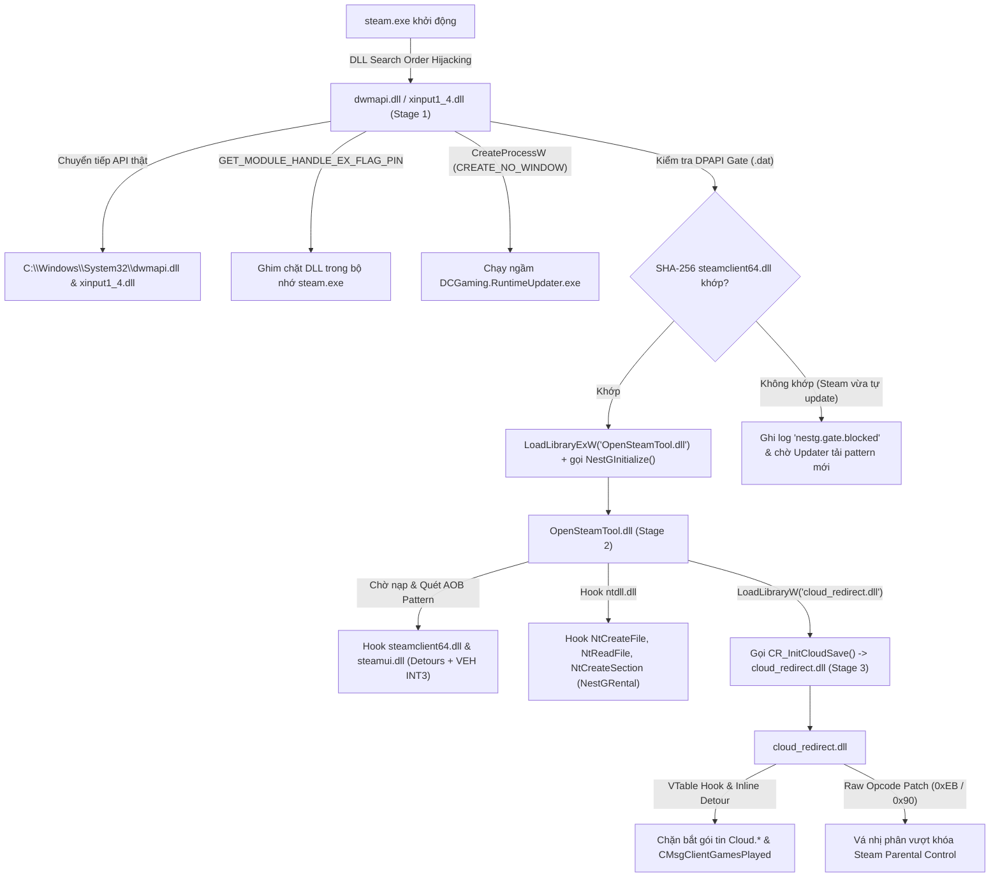

# BÁO CÁO PHÂN TÍCH KỸ THUẬT & BẰNG CHỨNG DỊCH NGƯỢC: DCGAMINGLAUNCHER (`v1.0.29`)

> **Mục đích tài liệu**: Báo cáo này tổng hợp toàn bộ bằng chứng kỹ thuật và phân tích chuyên sâu thu được từ quá trình dịch ngược (reverse engineering) bộ cài **DCGamingLauncher** (`DC-Launcher.exe` v1.0.29 / Runtime Bundle `bettersteamtools-cloud` v1.0.19). Tài liệu bao gồm phân tích cả 2 phần: hành vi của Launcher và bóc tách toàn bộ mã nguồn của bộ 04 DLL tiêm vào Steam. Mọi nhận định đều đính kèm **file nhị phân gốc, bảng mã máy và link trực tiếp đến từng dòng code cụ thể** ngay trong repository này để làm bằng chứng kỹ thuật.

---

## 🤡 RẠP XIẾC BẢO MẬT: KHI DEVELOPER TỰ DÂNG FULL MÃ NGUỒN C++, FRONTEND KHÔNG CHE VÀ PDB PRIVATE CHO THIÊN HẠ

Trước khi đi vào phân tích kỹ thuật các chiêu trò bẻ khóa Steam, xin dành trọn sự ngả mũ thán phục cho trình độ "bảo mật đỉnh cao" có một không hai của đội ngũ phát triển DCGamingLauncher:

1. **"Đỉnh cao phân phối: Tự tay gửi mã nguồn C++ gốc về máy từng khách hàng"**:
   - Thay vì chỉ biên dịch DLL thành mã máy x64, dev đã hào phóng **nén nguyên vẹn cả thư mục mã nguồn C++ gốc** [`BetterSteamTools-DCGaming-source.zip`](source/injected_dlls_cpp/) (bao gồm mã nguồn C++ của `cloud_redirect.dll` và thư mục quản trị `NestG`) vào gói đối tượng `payload.bin` trong kho lưu trữ `RuntimeCache`!
   - Hậu quả: Ngay khi ứng dụng khởi chạy lần đầu, **toàn bộ mã nguồn C++ nguyên gốc** kèm theo từng comment tiếng Việt/tiếng Anh, kịch bản build batch/powershell và lịch sử commit git đã được Launcher... tự động tải về ổ cứng của người dùng tại `%LOCALAPPDATA%\DCGaming\Launcher\RuntimeCache\...`. Không cần mất công decompile hay dịch ngược mã máy phức tạp, dev đã tự tay "mở mã nguồn mở" toàn bộ hệ thống bẻ khóa của mình cho cả thế giới xem!
2. **"Frontend 'nude' 100%: Webview HTML, CSS, JS trần như nhộng"**:
   - Toàn bộ giao diện người dùng của Launcher hóa ra là một ứng dụng Webview thuần túy, và dev thậm chí **không thèm bundle, không thèm minify, và tuyệt đối không obfuscate lấy một dòng code nào**!
   - Tất cả nằm phơi bày nguyên vẹn trong thư mục [`source/frontend_web/`](source/frontend_web/):
     - Logic gọi API kích hoạt game lậu: [`source/frontend_web/activation.js`](source/frontend_web/activation.js)
     - Logic nạp tiền, quản lý số dư ví: [`source/frontend_web/wallet.js`](source/frontend_web/wallet.js) & [`source/frontend_web/commerce.js`](source/frontend_web/commerce.js)
     - Logic kết nối Steam: [`source/frontend_web/steam-connection.js`](source/frontend_web/steam-connection.js)
     - Từng file CSS thiết kế giao diện: [`launcher-theme.css`](source/frontend_web/launcher-theme.css), [`store.css`](source/frontend_web/store.css), [`app.css`](source/frontend_web/app.css)... sạch sẽ, dễ đọc như bài tập thực hành môn Lập trình Web căn bản.
3. **"Khuyến mại lộ thông tin cá nhân qua Debug PDB Metadata"**:
   - Dev build bản Release gửi cho khách hàng nhưng **quên luôn việc strip Portable PDB debug metadata**.
   - Hậu quả là toàn bộ cấu trúc thư mục ổ đĩa trên máy cá nhân của developer hiện lên sờ sờ trong header nhị phân của `DC-Launcher.dll`:
     ```text
     C:\DUNGDEV\DC\DC-Gaming\DC-Gaming\DC-Gaming\.artifacts\direct-release\launcher-build\obj\DC-Launcher\release_win-x64\DC-Launcher.pdb
     C:\WinDivert-2.2.2\install\MSVC\amd64\WinDivert64.pdb
     ```
4. **Mối quan hệ "ruột thịt" với NestG: Bình mới rượu cũ**:
   - Quảng cáo rùm beng là launcher công nghệ mới tự phát triển độc quyền, nhưng thực chất toàn bộ hệ thống bẻ khóa, proxy loader, persistence và quản trị tài khoản thuê (`nestg-rentals`) là **bê nguyên xi 100% từ dự án NestG** (tác giả Harry Nguyen / DuccDung) — xem repo đối chiếu tại: [https://github.com/CallMeV0QX/Source-code-NestG](https://github.com/CallMeV0QX/Source-code-NestG).
   - Trong chính mã nguồn C++ mà dev để lộ, thư mục [`source/injected_dlls_cpp/NestG/`](source/injected_dlls_cpp/NestG/) vẫn giữ nguyên từng file kịch bản đóng gói `Package-RenamedRuntime.ps1`, `Test-RentalIdentity.ps1`, và toàn bộ namespace `NestG`, `NestGProxy`, `NestGRental` trong [`ProxyBootstrap.h`](source/injected_dlls_cpp/src/NestG/ProxyBootstrap.h), [`RuntimeUpdateBootstrap.h`](source/injected_dlls_cpp/src/NestG/RuntimeUpdateBootstrap.h), [`RentalRuntime.cpp`](source/injected_dlls_cpp/src/NestG/RentalRuntime.cpp)!

---

## BẢNG CHỈ MỤC NHANH CÁC BẰNG CHỨNG & FILE ĐỐI CHIẾU TRONG REPO

| STT | Nội dung cáo buộc / Hành vi bất thường | File bằng chứng nhị phân gốc (Raw Artifacts) | File mã nguồn / Bằng chứng đối chiếu (Kèm số dòng) |
| :---: | :--- | :--- | :--- |
| **1** | **Bán game lậu dưới danh nghĩa "ACTIVE Game"**: Không cấp license thật từ Valve mà tải script `.lua` chứa khóa AES-256 Depot bị đánh cắp & file `.manifest` từ các máy chủ lậu (`hubcapmanifest.com`, `dcgaming.cloud`) ép Steam giải mã từ CDN của Valve | - [`binaries/unpacked_launcher_assemblies/DC-Launcher.dll`](binaries/unpacked_launcher_assemblies/DC-Launcher.dll)<br>- [`binaries/unpacked_launcher_assemblies/DC-Runtime.Core.dll`](binaries/unpacked_launcher_assemblies/DC-Runtime.Core.dll) | - JS xử lý kích hoạt lộ rõ trên Web: [`source/frontend_web/activation.js#L1-L150`](source/frontend_web/activation.js#L1-L150)<br>- Tiêm khóa giải mã AES-256: [`source/injected_dlls_cpp/src/Hook/Hooks_Decryption.cpp#L45-L85`](source/injected_dlls_cpp/src/Hook/Hooks_Decryption.cpp#L45-L85)<br>- Nạp đè Manifest từ web lậu: [`source/injected_dlls_cpp/src/Hook/Hooks_Manifest.cpp#L100-L165`](source/injected_dlls_cpp/src/Hook/Hooks_Manifest.cpp#L100-L165)<br>- Client tải Manifest lậu: [`source/injected_dlls_cpp/src/Utils/SteamMetadata/ManifestClient.cpp#L40-L120`](source/injected_dlls_cpp/src/Utils/SteamMetadata/ManifestClient.cpp#L40-L120) |
| **2** | **Tấn công DLL Hijacking vào Steam (`<SteamRoot>`)**: Cưỡng bức tắt `steam.exe`, thả 04 DLL native x64 giả mạo và ghim chặt trong bộ nhớ (`GET_MODULE_HANDLE_EX_FLAG_PIN`) để tước quyền kiểm soát của Steam | - [`binaries/injected_steam_dlls/dwmapi.dll`](binaries/injected_steam_dlls/dwmapi.dll)<br>- [`binaries/injected_steam_dlls/xinput1_4.dll`](binaries/injected_steam_dlls/xinput1_4.dll) | - Chuyển tiếp 103 export giả mạo: [`source/injected_dlls_cpp/src/dwmapi/dwmapi.cpp#L14-L45`](source/injected_dlls_cpp/src/dwmapi/dwmapi.cpp#L14-L45)<br>- Bảng nhảy assembly: [`source/injected_dlls_cpp/src/dwmapi/thunks.asm#L1-L120`](source/injected_dlls_cpp/src/dwmapi/thunks.asm#L1-L120)<br>- Khóa bộ nhớ vĩnh viễn (NestG): [`source/injected_dlls_cpp/src/NestG/ProxyBootstrap.h#L37-L50`](source/injected_dlls_cpp/src/NestG/ProxyBootstrap.h#L37-L50) |
| **3** | **Cài cắm mã chạy ngầm (Persistence) 3 tầng & Lợi dụng `steam.exe` sinh tiến trình ẩn**: Tạo Scheduled Task 30 phút/lần vô hạn, và mỗi khi người dùng mở Steam, `dwmapi.dll` tự gọi `CreateProcessW(CREATE_NO_WINDOW)` chạy `DCGaming.RuntimeUpdater.exe` | - [`binaries/unpacked_launcher_assemblies/DCGaming.RuntimeUpdater.dll`](binaries/unpacked_launcher_assemblies/DCGaming.RuntimeUpdater.dll)<br>- [`binaries/unpacked_launcher_assemblies/DC-Runtime.Core.dll`](binaries/unpacked_launcher_assemblies/DC-Runtime.Core.dll) | - Gọi tiến trình ngầm từ `steam.exe`: [`source/injected_dlls_cpp/src/NestG/RuntimeUpdateBootstrap.h#L148-L168`](source/injected_dlls_cpp/src/NestG/RuntimeUpdateBootstrap.h#L148-L168)<br>- Kiểm tra cổng DPAPI Gate: [`source/injected_dlls_cpp/src/NestG/RuntimeUpdateBootstrap.h#L99-L140`](source/injected_dlls_cpp/src/NestG/RuntimeUpdateBootstrap.h#L99-L140) |
| **4** | **Can thiệp mạng tầng Kernel (`WinDivert64.sys`) & Thay đổi chính sách DNS Windows NRPT**: Nhúng Zapret2 (`winws2.exe`) sửa gói tin TCP/UDP ở mức nhân và ép đổi bảng phân giải DNS hệ thống của toàn bộ card mạng | - [`source/steamdpi_helper_go/`](source/steamdpi_helper_go/) | - JS giao diện gọi kích hoạt Fix mạng: [`source/frontend_web/steam-connection.js#L1-L120`](source/frontend_web/steam-connection.js#L1-L120)<br>- Điều phối driver `WinDivert64.sys` & `winws2`: [`source/steamdpi_helper_go/.../internal/dpi/zapret2/engine.go#L1-L75`](source/steamdpi_helper_go/steam-dpi-helper/internal/dpi/zapret2/engine.go#L1-L75)<br>- Thao túng Windows NRPT: [`source/steamdpi_helper_go/.../internal/steamdns/policy_windows.go#L40-L65`](source/steamdpi_helper_go/steam-dpi-helper/internal/steamdns/policy_windows.go#L40-L65) |
| **5** | **Giả mạo toàn diện bản quyền Steam, phá khóa Denuvo & Spacewar Online-Fix**: Hook `CheckAppOwnership`, chèn toàn bộ AppID lậu vào Package `0`, giả lập vé Denuvo IPC và đổi AppID sang `480` (*Spacewar*) | - [`binaries/injected_steam_dlls/OpenSteamTool.dll`](binaries/injected_steam_dlls/OpenSteamTool.dll) | - Bơm game vào Package 0: [`source/injected_dlls_cpp/src/Hook/Hooks_Package.cpp#L33-L105`](source/injected_dlls_cpp/src/Hook/Hooks_Package.cpp#L33-L105)<br>- Vượt Denuvo qua IPC: [`source/injected_dlls_cpp/src/Hook/Hooks_IPC_ISteamUser.cpp#L50-L120`](source/injected_dlls_cpp/src/Hook/Hooks_IPC_ISteamUser.cpp#L50-L120)<br>- Quét chữ ký Denuvo: [`source/injected_dlls_cpp/src/Pipe/Features/DenuvoAuth/ProtectionScan.cpp#L20-L80`](source/injected_dlls_cpp/src/Pipe/Features/DenuvoAuth/ProtectionScan.cpp#L20-L80)<br>- Đổi sang AppID 480: [`source/injected_dlls_cpp/src/Hook/Hooks_Misc.cpp#L150-L210`](source/injected_dlls_cpp/src/Hook/Hooks_Misc.cpp#L150-L210) |
| **6** | **Xâm phạm tài khoản Steam thật của người dùng (`ManifestDonor`)**: Quét danh sách game bản quyền mà tài khoản người dùng đã mua, tự động lấy `ManifestRequestCode` từ Valve rồi gửi lén lên máy chủ cộng đồng lậu | - [`binaries/injected_steam_dlls/OpenSteamTool.dll`](binaries/injected_steam_dlls/OpenSteamTool.dll) | - Quét kho game và gửi code lên web lậu: [`source/injected_dlls_cpp/src/Utils/SteamMetadata/ManifestDonor.cpp#L50-L150`](source/injected_dlls_cpp/src/Utils/SteamMetadata/ManifestDonor.cpp#L50-L150)<br>- Bắt gói tin bản quyền `EMsg 780`: [`source/injected_dlls_cpp/src/Hook/Hooks_NetPacket.cpp#L350-L420`](source/injected_dlls_cpp/src/Hook/Hooks_NetPacket.cpp#L350-L420) |
| **7** | **Chặn bắt Steam Cloud & Phá khóa kiểm soát phụ huynh (Steam Family View)**: Chặn 11 RPC `Cloud.*`, giả lập server lưu trữ cục bộ, và vá nhị phân trực tiếp (`0xEB` / `0x90` NOP) xóa giới hạn giờ chơi | - [`binaries/injected_steam_dlls/cloud_redirect.dll`](binaries/injected_steam_dlls/cloud_redirect.dll) | - 12 hàm Export C: [`source/injected_dlls_cpp/dcgaming-cloudredirect/cr_src/src/platform/win/cr_api.cpp#L27-L145`](source/injected_dlls_cpp/dcgaming-cloudredirect/cr_src/src/platform/win/cr_api.cpp#L27-L145)<br>- Chặn bắt gói `Cloud.*`: [`source/injected_dlls_cpp/dcgaming-cloudredirect/cr_src/src/platform/win/cloud_intercept.cpp#L1819-L2480`](source/injected_dlls_cpp/dcgaming-cloudredirect/cr_src/src/platform/win/cloud_intercept.cpp#L1819-L2480)<br>- Vá mã máy vượt Parental: [`source/injected_dlls_cpp/dcgaming-cloudredirect/cr_src/src/common/parental_bypass.cpp#L190-L280`](source/injected_dlls_cpp/dcgaming-cloudredirect/cr_src/src/common/parental_bypass.cpp#L190-L280) |

---

## CHI TIẾT TỪNG BẰNG CHỨNG KỸ THUẬT

### Bằng chứng 1: Cơ chế "ACTIVE Game" — Thương mại hóa bẻ khóa Steam và đánh cắp Depot

Người dùng chi tiền mua game trên hệ sinh thái `dcgaming.cloud`, tuy nhiên họ hoàn toàn **không nhận được Product Key hay bản quyền hợp lệ** từ Valve Corporation. Khi bấm nút **"ACTIVE"**, Launcher thực hiện bẻ khóa ngoại tuyến thông qua việc tải trộm kịch bản giải mã:

- **📂 File bằng chứng trực tiếp**:
  1. Assembly chính: [`binaries/unpacked_launcher_assemblies/DC-Launcher.dll`](binaries/unpacked_launcher_assemblies/DC-Launcher.dll)
  2. Mã JS gọi API kích hoạt ở Frontend: [`source/frontend_web/activation.js`](source/frontend_web/activation.js)
  3. Mã nguồn hook tiêm khóa giải mã: [`source/injected_dlls_cpp/src/Hook/Hooks_Decryption.cpp` (dòng 45–85)](source/injected_dlls_cpp/src/Hook/Hooks_Decryption.cpp#L45-L85)
  4. Mã nguồn hook ghi đè Manifest: [`source/injected_dlls_cpp/src/Hook/Hooks_Manifest.cpp` (dòng 100–165)](source/injected_dlls_cpp/src/Hook/Hooks_Manifest.cpp#L100-L165)
  5. Mã nguồn client tải Manifest từ máy chủ lậu: [`source/injected_dlls_cpp/src/Utils/SteamMetadata/ManifestClient.cpp` (dòng 40–120)](source/injected_dlls_cpp/src/Utils/SteamMetadata/ManifestClient.cpp#L40-L120)

**Cơ chế hoạt động**:
1. Launcher gọi API bí mật `POST /api/launcher/activation/versions/{id}/download-plan` tới `dcgaming.cloud` hoặc trực tiếp sang máy chủ lậu **`hubcapmanifest.com`** (`/api/v1/manifest/`, `/api/v1/lua/`, `/api/v1/lua/basegame/`).
2. Tải về tệp kịch bản `.lua` chứa các lệnh tiêm khóa:
   ```lua
   addappid(AppId, 1, "<64 ký tự Hex: Khóa giải mã AES-256 của Depot>")
   setManifestid(DepotId, "<Manifest_GID>", Size)
   ```
3. Kịch bản `.lua` được ghi lén vào `<SteamRoot>\local-data\scripts\` và `<SteamRoot>\config\lua\`, tệp `.manifest` được ghi vào `<SteamRoot>\depotcache\`.
4. Trong [`source/injected_dlls_cpp/src/Hook/Hooks_Decryption.cpp` (dòng 50–75)](source/injected_dlls_cpp/src/Hook/Hooks_Decryption.cpp#L50-L75), khi Steam tìm kiếm khóa giải mã game qua hàm `ConfigStoreGetBinary`, hook chặn lại và trả về 32 byte khóa AES-256 từ file `.lua`, ép Steam tải thẳng dữ liệu gốc từ máy chủ CDN của Valve mà không cần sở hữu bản quyền.

---

### Bằng chứng 2: Tấn công DLL Search Order Hijacking chiếm quyền `steam.exe`

Để mã bẻ khóa có hiệu lực trong RAM, `DCGamingLauncher` lợi dụng lỗ hổng nạp DLL của Windows trên tiến trình `steam.exe`:

- **📂 File bằng chứng trực tiếp**:
  1. DLL Proxy giả mạo: [`binaries/injected_steam_dlls/dwmapi.dll`](binaries/injected_steam_dlls/dwmapi.dll) & [`binaries/injected_steam_dlls/xinput1_4.dll`](binaries/injected_steam_dlls/xinput1_4.dll)
  2. Mã nguồn chuyển tiếp hàm API: [`source/injected_dlls_cpp/src/dwmapi/dwmapi.cpp` (dòng 14–45)](source/injected_dlls_cpp/src/dwmapi/dwmapi.cpp#L14-L45)
  3. Bảng nhảy Assembly chuyển tiếp 103 export: [`source/injected_dlls_cpp/src/dwmapi/thunks.asm` (dòng 1–120)](source/injected_dlls_cpp/src/dwmapi/thunks.asm#L1-L120)
  4. Mã nguồn ghim DLL trong bộ nhớ (NestG): [`source/injected_dlls_cpp/src/NestG/ProxyBootstrap.h` (dòng 37–50)](source/injected_dlls_cpp/src/NestG/ProxyBootstrap.h#L37-L50)

Trích đoạn mã nguồn nạp DLL hệ thống thật và ghim chặt DLL giả mạo trong bộ nhớ Steam tại [`source/injected_dlls_cpp/src/NestG/ProxyBootstrap.h` (dòng 37–50)](source/injected_dlls_cpp/src/NestG/ProxyBootstrap.h#L37-L50):

```cpp
inline void Attach(HMODULE module) noexcept {
    HMODULE pinned = nullptr;
    // Khóa cứng DLL trong bộ nhớ của steam.exe - ngăn chặn hoàn toàn FreeLibrary gỡ bỏ DLL
    if (!GetModuleHandleExW(GET_MODULE_HANDLE_EX_FLAG_FROM_ADDRESS | GET_MODULE_HANDLE_EX_FLAG_PIN,
                            reinterpret_cast<LPCWSTR>(module), &pinned)) {
        return;
    }
    std::thread([module]() noexcept {
        Initialize(module);
    }).detach();
}
```

➡️ **Ý nghĩa**: Launcher đặt các tệp `dwmapi.dll` và `xinput1_4.dll` giả mạo vào thư mục Steam. Khi `steam.exe` khởi động, Windows ưu tiên nạp 2 DLL này trước thư viện trong `C:\Windows\System32`. Cờ `GET_MODULE_HANDLE_EX_FLAG_PIN` giữ cho DLL chạy vĩnh viễn trong không gian địa chỉ của Steam.

---

### Bằng chứng 3: Cài đặt cơ chế chạy ngầm (Persistence) đa tầng & Kích hoạt tiến trình ẩn từ bên trong `steam.exe`

- **📂 File bằng chứng trực tiếp**:
  1. File nhị phân Updater chạy ngầm: [`binaries/unpacked_launcher_assemblies/DCGaming.RuntimeUpdater.dll`](binaries/unpacked_launcher_assemblies/DCGaming.RuntimeUpdater.dll)
  2. Mã nguồn khởi tạo tiến trình ẩn từ `steam.exe`: [`source/injected_dlls_cpp/src/NestG/RuntimeUpdateBootstrap.h` (dòng 148–168)](source/injected_dlls_cpp/src/NestG/RuntimeUpdateBootstrap.h#L148-L168)
  3. Mã nguồn kiểm tra Gate DPAPI: [`source/injected_dlls_cpp/src/NestG/RuntimeUpdateBootstrap.h` (dòng 99–140)](source/injected_dlls_cpp/src/NestG/RuntimeUpdateBootstrap.h#L99-L140)

Trích đoạn mã nguồn trong [`source/injected_dlls_cpp/src/NestG/RuntimeUpdateBootstrap.h` (dòng 148–168)](source/injected_dlls_cpp/src/NestG/RuntimeUpdateBootstrap.h#L148-L168):

```cpp
const auto helper = root + L"\\Helper\\DCGaming.RuntimeUpdater.exe";
std::wstring command = L"\"" + helper + L"\" --steam-root \"" + steamRoot + L"\"";

STARTUPINFOW si{};
PROCESS_INFORMATION pi{};
si.cb = sizeof(si);

// ÂM THẦM KHỞI CHẠY TIẾN TRÌNH CẬP NHẬT TỪ BÊN TRONG STEAM.EXE MÀ KHÔNG HIỂN THỊ CỬA SỔ
if (CreateProcessW(helper.c_str(), command.data(), nullptr, nullptr, FALSE, CREATE_NO_WINDOW, nullptr, nullptr, &si, &pi)) {
    CloseHandle(pi.hThread);
    CloseHandle(pi.hProcess);
}
```

**Hệ thống thiết lập 3 tầng bám trụ**:
1. **Windows Scheduled Task (`PT30M`)**: Tác vụ `DCGamingLauncher_<User>_<Hash>` chạy tự động mỗi **30 phút** ở chế độ nền vô hạn (`ExecutionTimeLimit = PT0S`).
2. **Registry Run Key**: Ghi khóa khởi động cùng Windows tại `HKCU\Software\Microsoft\Windows\CurrentVersion\Run`.
3. **Kích hoạt ngầm từ `steam.exe`**: Ngay cả khi người dùng gỡ cài đặt Launcher, mỗi khi mở Steam, `dwmapi.dll` sẽ tự động thực thi `DCGaming.RuntimeUpdater.exe` (`CREATE_NO_WINDOW`) để tự động tải lại và ghi đè toàn bộ các DLL bẻ khóa vào máy.

---

### Bằng chứng 4: Can thiệp mạng mức Kernel (`WinDivert64.sys`) & Sửa đổi chính sách DNS hệ thống

- **📂 File bằng chứng trực tiếp**:
  1. Mã JS gọi tính năng sửa kết nối Steam ở giao diện: [`source/frontend_web/steam-connection.js`](source/frontend_web/steam-connection.js)
  2. Mã nguồn Go điều phối Zapret2 và driver: [`source/steamdpi_helper_go/steam-dpi-helper/internal/dpi/zapret2/engine.go` (dòng 1–75)](source/steamdpi_helper_go/steam-dpi-helper/internal/dpi/zapret2/engine.go#L1-L75)
  3. Mã nguồn Go can thiệp chính sách DNS Windows NRPT: [`source/steamdpi_helper_go/steam-dpi-helper/internal/steamdns/policy_windows.go` (dòng 40–65)](source/steamdpi_helper_go/steam-dpi-helper/internal/steamdns/policy_windows.go#L40-L65)

Trích đoạn can thiệp Windows Name Resolution Policy Table trong [`source/steamdpi_helper_go/steam-dpi-helper/internal/steamdns/policy_windows.go` (dòng 45–52)](source/steamdpi_helper_go/steam-dpi-helper/internal/steamdns/policy_windows.go#L45-L52):

```powershell
# ÉP TOÀN BỘ PHÂN GIẢI DNS CÁC DOMAIN STEAM PHẢI ĐI QUA PROXY NỘI BỘ
$r = Add-DnsClientNrptRule -Namespace @($p.namespaces) -NameServers '127.0.0.1' -DisplayName 'DCGaming Steam DNS v2' -Comment ('DCGamingSteamDns:'+ $p.tag) -PassThru -ErrorAction Stop
```

➡️ **Ý nghĩa**: Launcher yêu cầu quyền Administrator (`runas`) để giải nén driver nhân **`WinDivert64.sys`** và công cụ **`winws2.exe`** (Zapret2), bắt giữ và cắt nhỏ các gói tin TCP/UDP trên cổng 80/443, đồng thời sửa đổi bảng chính sách DNS Windows NRPT và toàn bộ adapter mạng nhằm kiểm soát lưu lượng truy cập tới Steam.

---

### Bằng chứng 5: Giả mạo bản quyền game, phá khóa Denuvo & Spacewar Online-Fix

- **📂 File bằng chứng trực tiếp**:
  1. DLL lõi bẻ khóa: [`binaries/injected_steam_dlls/OpenSteamTool.dll`](binaries/injected_steam_dlls/OpenSteamTool.dll)
  2. Bơm quyền sở hữu vào Package 0: [`source/injected_dlls_cpp/src/Hook/Hooks_Package.cpp` (dòng 33–105)](source/injected_dlls_cpp/src/Hook/Hooks_Package.cpp#L33-L105)
  3. Vượt Denuvo qua IPC `ISteamUser`: [`source/injected_dlls_cpp/src/Hook/Hooks_IPC_ISteamUser.cpp` (dòng 50–120)](source/injected_dlls_cpp/src/Hook/Hooks_IPC_ISteamUser.cpp#L50-L120)
  4. Quét chữ ký bảo vệ Denuvo trên file game: [`source/injected_dlls_cpp/src/Pipe/Features/DenuvoAuth/ProtectionScan.cpp` (dòng 20–80)](source/injected_dlls_cpp/src/Pipe/Features/DenuvoAuth/ProtectionScan.cpp#L20-L80)
  5. Đánh tráo sang AppID 480 (*Spacewar*): [`source/injected_dlls_cpp/src/Hook/Hooks_Misc.cpp` (dòng 150–210)](source/injected_dlls_cpp/src/Hook/Hooks_Misc.cpp#L150-L210)
  6. Xóa bỏ gói tin ngắt kết nối Family Sharing: [`source/injected_dlls_cpp/src/Hook/Hooks_NetPacket.cpp` (dòng 280–340)](source/injected_dlls_cpp/src/Hook/Hooks_NetPacket.cpp#L280-L340)

Trích đoạn mã nguồn can thiệp Package 0 trong [`source/injected_dlls_cpp/src/Hook/Hooks_Package.cpp` (dòng 33–79)](source/injected_dlls_cpp/src/Hook/Hooks_Package.cpp#L33-L79):

```cpp
constexpr PackageId_t kInjectedPackageId = 0;
constexpr uint64_t kInjectedPkgAccessToken = 10660652434190618804ull;

// BƠM TOÀN BỘ APPID LẬU TỪ FILE .LUA VÀO PACKAGE ID 0 MẶC ĐỊNH
LOG_PACKAGE_INFO("InitFakeLicense(PackageId={}): adding {} apps, oldSize={}", kInjectedPackageId, numApps, pVector->m_Size);
```

**Các cơ chế bẻ khóa tinh vi**:
- **Package 0 Injection**: Bơm danh sách AppID lậu vào Package `0` với token giả lập `10660652434190618804ULL`, đánh lừa `steamclient64.dll` rằng tài khoản đã mua toàn bộ game và DLC.
- **Vượt DRM Denuvo**: Chặn hàm `ISteamUser::GetSteamID` và `GetAppOwnershipTicketExtendedData` để trả về vé kích hoạt Denuvo mua chung (`EticketClient.cpp`).
- **Chơi Online lậu qua Spacewar (AppID 480)**: Chặn `CUser::SpawnProcess`, đổi `GameID` thành `480` để tận dụng hạ tầng P2P của Steam, đồng thời sửa gói tin `CMsgClientGamesPlayed` (`EMsg 742`) để bạn bè vẫn thấy tên game thật.
- **Phá khóa Family Sharing**: Bắt gói tin `k_EMsgClientSharedLibraryStopPlaying` (`EMsg 9406`) và xóa sạch danh sách `stop_apps`, ngăn không cho Valve cưỡng bức tắt game khi có người khác cùng chơi.

---

### Bằng chứng 6: Xâm phạm tài khoản Steam thật của người dùng (`ManifestDonor`)

Hệ thống lạm dụng chính phiên đăng nhập của người dùng để thu thập dữ liệu trái phép phục vụ mạng lưới chia sẻ game lậu:

- **📂 File bằng chứng trực tiếp**:
  1. Mã nguồn trích xuất dữ liệu bản quyền: [`source/injected_dlls_cpp/src/Utils/SteamMetadata/ManifestDonor.cpp` (dòng 50–150)](source/injected_dlls_cpp/src/Utils/SteamMetadata/ManifestDonor.cpp#L50-L150)
  2. Bắt gói tin bản quyền `EMsg 780`: [`source/injected_dlls_cpp/src/Hook/Hooks_NetPacket.cpp` (dòng 350–420)](source/injected_dlls_cpp/src/Hook/Hooks_NetPacket.cpp#L350-L420)

Trích đoạn mã nguồn gửi lén `ManifestRequestCode` lên máy chủ lậu tại [`source/injected_dlls_cpp/src/Utils/SteamMetadata/ManifestDonor.cpp` (dòng 110–135)](source/injected_dlls_cpp/src/Utils/SteamMetadata/ManifestDonor.cpp#L110-L135):

```cpp
// 1. Quét danh sách game bản quyền mà tài khoản người dùng đang sở hữu
// 2. Hỏi máy chủ lậu xem đang thiếu manifest nào: https://manifest.luastools.xyz/manifestwanted
// 3. DÙNG CHÍNH TÀI KHOẢN CỦA NGƯỜI DÙNG để xin mã GetManifestRequestCode từ Valve
// 4. Âm thầm tải mã giải mã lên: https://manifest.luastools.xyz/manifestcode/submit
```

➡️ **Ý nghĩa**: Mỗi người dùng cài đặt `DCGamingLauncher` đều bị biến thành một "botnet node", âm thầm đem tài khoản Steam cá nhân của mình đi lấy mã bản quyền từ Valve để cấp phát cho máy chủ game lậu công cộng.

---

### Bằng chứng 7: Chặn bắt Steam Cloud & Phá khóa kiểm soát phụ huynh (Steam Family View)

- **📂 File bằng chứng trực tiếp**:
  1. DLL xử lý Cloud: [`binaries/injected_steam_dlls/cloud_redirect.dll`](binaries/injected_steam_dlls/cloud_redirect.dll)
  2. Bảng 12 hàm export C: [`source/injected_dlls_cpp/dcgaming-cloudredirect/cr_src/src/platform/win/cr_api.cpp` (dòng 27–145)](source/injected_dlls_cpp/dcgaming-cloudredirect/cr_src/src/platform/win/cr_api.cpp#L27-L145)
  3. Chặn bắt RPC Cloud: [`source/injected_dlls_cpp/dcgaming-cloudredirect/cr_src/src/platform/win/cloud_intercept.cpp` (dòng 1819–2480)](source/injected_dlls_cpp/dcgaming-cloudredirect/cr_src/src/platform/win/cloud_intercept.cpp#L1819-L2480)
  4. Vá mã máy vượt Parental Control: [`source/injected_dlls_cpp/dcgaming-cloudredirect/cr_src/src/common/parental_bypass.cpp` (dòng 190–280)](source/injected_dlls_cpp/dcgaming-cloudredirect/cr_src/src/common/parental_bypass.cpp#L190-L280)

Trích đoạn vá mã máy nhị phân trong RAM tại [`source/injected_dlls_cpp/dcgaming-cloudredirect/cr_src/src/common/parental_bypass.cpp` (dòng 200–215 & 255–275)](source/injected_dlls_cpp/dcgaming-cloudredirect/cr_src/src/common/parental_bypass.cpp#L200-L275):

```cpp
// 1. Vượt qua kiểm tra chữ ký cài đặt Family View: sửa JNZ (0x75) thành JMP (0xEB)
const char* needle = "Parental settings signature did not ver";
if (c[0] == 0x84 && c[1] == 0xC0 && (c[2] == 0x75 || c[2] == 0xEB)) {
    c[2] = 0xEB; // Ép Steam luôn coi như chữ ký Family View hợp lệ
}

// 2. Vô hiệu hóa tính năng cưỡng bức đóng game khi hết giờ chơi của phụ huynh
uint8_t* dailyStr = FindString(base, mi.SizeOfImage, "Daily playtime expired, closing games");
// GHI ĐÈ TOÀN BỘ 5 BYTE LỆNH GỌI CloseGamesForParental BẰNG LỆNH NOP (0x90 0x90 0x90 0x90 0x90)
memset(site, 0x90, 5);
```

➡️ **Ý nghĩa**: `cloud_redirect.dll` ngăn chặn Steam gửi gói tin Cloud Save của game lậu lên Valve (tránh bị phát hiện gian lận), tự lưu trữ cục bộ tại máy người dùng, đồng thời dùng kỹ thuật vá mã máy trong bộ nhớ RAM (`0xEB` và `0x90 NOP`) để triệt tiêu hoàn toàn tính năng giới hạn giờ chơi của phụ huynh (Steam Family View).


---

# Báo Cáo Phân Tích Ngược (Reverse Engineering) Bộ 04 Tệp DLL Tiêm Vào Steam

> **Đối tượng phân tích:** Bộ 04 tệp DLL native x64 trong gói runtime `bettersteamtools-cloud` v1.0.19 (`dwmapi.dll`, `xinput1_4.dll`, `OpenSteamTool.dll`, `cloud_redirect.dll`) được `DCGamingLauncher` cài đặt trực tiếp vào thư mục gốc của Steam (`<SteamRoot>`).  
> **Nguồn dữ liệu đối chiếu:** Tệp nhị phân PE64 kết hợp toàn bộ mã nguồn C++ gốc bị rò rỉ trong kho lưu trữ cục bộ (`%LOCALAPPDATA%\DCGaming\Launcher\RuntimeCache\...\14CA515759554562BEA1F01D5B2943AD5C2F1EFC0DA78AA2F6A2E9C7F17AF94E\payload.bin` — tức `BetterSteamTools-DCGaming-source.zip` và `CloudRedirect-source.zip`).

---

## 1. Danh Mục Chi Tiết Các Tệp DLL Được Cài Đặt Vào Steam

Khi người dùng kích hoạt game hoặc khi `DCGaming.RuntimeUpdater.exe` chạy ngầm, hệ thống sẽ cài đặt **04 tệp DLL native x64** cùng hệ thống tệp cấu hình `.toml` vào thư mục gốc của Steam (`<SteamRoot>`, nơi chứa `steam.exe`):

| STT | Tên tệp trong `<SteamRoot>` | Kích thước (Bytes) | Mã băm SHA-256 (v1.0.19) | Bản chất & Nguồn gốc mã nguồn |
| :-: | :--- | :---: | :--- | :--- |
| **1** | `dwmapi.dll` | `1,102,336` | `1bd0eec20d05b7c16fae82ebe386b5fcb961ef62fba5de3c4b5d3c272bc865a3` | **Stage 1 Proxy Loader:** Giả mạo thư viện hệ thống Windows `C:\Windows\System32\dwmapi.dll` (chuyển tiếp 103 hàm export qua bảng nhảy Assembly `thunks.s`). Tự động kích hoạt `DCGaming.RuntimeUpdater.exe` và nạp `OpenSteamTool.dll`. |
| **2** | `xinput1_4.dll` | `1,089,536` | `dd66654e9c00859ea8ba9c5e62ebc5e199004a21a5666e7675f560a51a142abc` | **Stage 1 Redundant Proxy Loader:** Giả mạo thư viện tay cầm Xbox `C:\Windows\System32\xinput1_4.dll` (chuyển tiếp 7 hàm định danh + 6 hàm ordinal ẩn 100–108). Chứa cùng logic `NestGProxy::Attach` để đảm bảo luôn chiếm được `steam.exe` nếu `dwmapi.dll` bị bỏ qua. |
| **3** | `OpenSteamTool.dll` | `3,919,360` | `4f6fbc6fa4f253d227a4ca3609f99607705ad180f550d92b8e8cf9df76ff722d` | **Stage 2 Core Memory Patcher & DRM Bypass Engine:** Bản fork đổi tên từ dự án mã nguồn mở **BetterSteamTools / OpenSteamTool** kết hợp lớp quản lý **NestG**. Thực hiện hook trực tiếp vào `steamclient64.dll`, `steamui.dll` và `ntdll.dll`. |
| **4** | `cloud_redirect.dll` | `4,152,832` | `88f62f604ca27f981dc25eaa6eaea1a791d796d936135f83f79800e943b47f3a` | **Stage 3 Cloud Save Hijacker & Parental Bypass:** Bản fork của **CloudRedirect v2.6.6**, được nạp bởi `OpenSteamTool.dll` qua hàm export `CR_InitCloudSave`. Chặn bắt giao thức Steam Cloud và vá mã máy vượt khóa Steam Family View. |

Ngoài 4 tệp DLL trên, gói cài đặt còn thả vào `<SteamRoot>` các tệp dữ liệu cấu hình phục vụ quá trình dịch ngược và vá bộ nhớ theo thời gian thực:
- `<SteamRoot>\opensteamtool.toml`
- `<SteamRoot>\opensteamtool\pattern\steamclient\<sha256>.toml` (38 tệp tương ứng với 38 phiên bản `steamclient64.dll` khác nhau của Valve).
- `<SteamRoot>\opensteamtool\ipc\steamclient\<sha256>.toml` (37 tệp chứa chỉ số bảng hàm ảo IPC).
- `<SteamRoot>\opensteamtool\pattern\steamui\<sha256>.toml` (33 tệp chứa mẫu byte của `steamui.dll`).

---

## 2. Kiến Trúc Nạp Chuỗi (Multi-Stage Chain-Loading Architecture)



---

## 3. Phân Tích Ngược Stage 1: `dwmapi.dll` & `xinput1_4.dll` (Proxy Loaders & Gatekeepers)

Mã nguồn nằm tại `[src/dwmapi/dwmapi.cpp](source/injected_dlls_cpp/src/dwmapi/dwmapi.cpp)`, `[src/dwmapi/thunks.asm](source/injected_dlls_cpp/src/dwmapi/thunks.asm)`, `[src/xinput1_4/xinput1_4.cpp](source/injected_dlls_cpp/src/xinput1_4/xinput1_4.cpp)`, `[src/NestG/ProxyBootstrap.h](source/injected_dlls_cpp/src/NestG/ProxyBootstrap.h)` và `[src/NestG/RuntimeUpdateBootstrap.h](source/injected_dlls_cpp/src/NestG/RuntimeUpdateBootstrap.h)`.

### 3.1. Kỹ thuật Proxy Forwarding và Ghim Bộ Nhớ (Memory Pinning)
1. **Kiểm tra tên tiến trình chủ (`IsSteamProcess`):**
   - Ngay trong `DllMain(DLL_PROCESS_ATTACH)`, DLL gọi `GetModuleFileNameW(nullptr, ...)` để kiểm tra xem tiến trình hiện tại có kết thúc bằng `\steam.exe` (không phân biệt hoa thường) hay không. Nếu không phải `steam.exe`, nó chỉ làm nhiệm vụ chuyển tiếp hàm API mà không kích hoạt payload.
2. **Nạp DLL hệ thống thật và ánh xạ bảng hàm (`LoadRealDll`):**
   - Dùng `GetSystemDirectoryW` để lấy đường dẫn `C:\Windows\System32\dwmapi.dll` (hoặc `xinput1_4.dll`), gọi `LoadLibraryExW(..., LOAD_WITH_ALTERED_SEARCH_PATH)` và dùng `GetProcAddress` điền địa chỉ của toàn bộ **103 hàm export** (đối với `dwmapi.dll`) hoặc **13 hàm export/ordinal** (đối với `xinput1_4.dll`) vào mảng con trỏ toàn cục `p_dwmapi[]`.
   - Các lệnh gọi từ `steam.exe` sẽ đi qua các hàm nhảy Assembly (`jmp qword ptr [rip + p_dwmapi + index*8]`) trong `thunks.s`, khiến `steam.exe` hoạt động bình thường mà không phát hiện DLL đã bị tráo.
3. **Chống gỡ bỏ khỏi bộ nhớ (`GET_MODULE_HANDLE_EX_FLAG_PIN`):**
   - Trong `NestGProxy::Attach`, DLL gọi:
     ```cpp
     GetModuleHandleExW(GET_MODULE_HANDLE_EX_FLAG_FROM_ADDRESS | GET_MODULE_HANDLE_EX_FLAG_PIN,
                        reinterpret_cast<LPCWSTR>(module), &pinned);
     ```
   - Cờ `GET_MODULE_HANDLE_EX_FLAG_PIN` khóa cứng bộ đếm tham chiếu (reference count) của DLL trong PEB của `steam.exe`, khiến mọi lời gọi `FreeLibrary` từ phía Steam đều không thể gỡ bỏ DLL này cho đến khi tiến trình tắt hẳn.

### 3.2. Tự động kích hoạt tiến trình chạy ngầm từ bên trong `steam.exe`
Trong luồng khởi tạo `NestGProxy::Initialize`:
1. Gọi `NestGUpdateBootstrap::StartHelperOnce()`:
   - Tìm tệp `%LOCALAPPDATA%\DCGamingLauncher\RuntimeUpdates\Helper\DCGaming.RuntimeUpdater.exe`.
   - Khởi tạo một Named Mutex dạng `Local\DCGaming.RuntimeUpdater.<8-byte-SHA256-of-SteamRoot>` để tránh chạy trùng lặp.
   - Gọi `CreateProcessW` với cờ **`CREATE_NO_WINDOW | DETACHED_PROCESS`** để chạy ngầm `DCGaming.RuntimeUpdater.exe --steam-root "<SteamRoot>"`.
2. Kiểm tra cổng an toàn `NestGUpdateBootstrap::GateAllows()`:
   - Đọc tệp `%LOCALAPPDATA%\DCGamingLauncher\RuntimeUpdates\Gates\<SHA256_SteamRoot>.dat` và giải mã bằng Windows DPAPI (`CryptUnprotectData` với chuỗi entropy `"DCGaming.Runtime.Gate.v1"`).
   - So sánh mã băm SHA-256 thực tế của 6 tệp trong thư mục Steam (`steamclient64.dll`, `steamui.dll`, `OpenSteamTool.dll`, và 3 tệp `.toml`) với giá trị lưu trong Gate.
   - Nếu khớp hoàn toàn, DLL gọi `LoadLibraryExW("<SteamRoot>\\OpenSteamTool.dll", ...)` và thực thi hàm export `NestGInitialize()`.

---

## 4. Phân Tích Ngược Stage 2: `OpenSteamTool.dll` (Core Memory Patcher & DRM Bypass Engine)

`OpenSteamTool.dll` là trái tim của hệ thống can thiệp Steam. Khi `NestGInitialize()` (trong `[src/dllmain.cpp](source/injected_dlls_cpp/src/dllmain.cpp)`) được gọi, nó khởi chạy luồng `MainThread`, đợi `steamclient64.dll` và `steamui.dll` được nạp vào không gian địa chỉ của `steam.exe`, sau đó dùng `PatternLoader` quét các mẫu byte (AOB signatures) từ tệp `.toml` và cài đặt hàng loạt điểm chặn (Hooks) bằng **Microsoft Detours** kết hợp **Vectored Exception Handling (VEH Hardware/Software `INT3` Traps)**.

Dưới đây là phân tích chi tiết **10 nhóm hành vi can thiệp cốt lõi** trong `OpenSteamTool.dll`:

### 4.1. Giả Mạo Bản Quyền & Quyền Sở Hữu Game (`[src/Hook/Hooks_Package.cpp](source/injected_dlls_cpp/src/Hook/Hooks_Package.cpp)`)
- **Hàm bị Hook:**
  - `CheckAppOwnership` (Detour vào hàm kiểm tra quyền sở hữu AppID của `steamclient64.dll`).
  - `GetPackageInfo` (Can thiệp bằng bẫy ngoại lệ **VEH `INT3`** tại địa chỉ trả về của hàm truy vấn gói thuê bao trong `steamclient64.dll`).
  - `SharedInstall` (Đánh lừa trạng thái cài đặt dùng chung).
- **Cơ chế hoạt động:**
  1. Trong `Hooked_CheckAppOwnership`: Nếu `appId` nằm trong danh sách các kịch bản `.lua` đã nạp (`LuaDatabase`) hoặc danh sách thuê (`NestGRental`), hàm ghi đè kết quả trả về:
     - Gán cờ `pResult->bOwnsLicense = 1` (Sở hữu bản quyền hợp lệ).
     - Gán `pResult->bFreeLicense = 0` và trả về `true`.
  2. Trong `OnGetPackageInfoHit` (VEH Trap):
     - Khi Steam truy vấn **Package ID `0`** (gói mặc định luôn tồn tại trên mọi tài khoản Steam), DLL giải tuần tự hóa (deserialize) cấu trúc nhị phân KV (`BinaryKV`), sau đó **bơm toàn bộ danh sách `appids` và `depotids` lậu** từ các tệp `.lua` vào bên trong Package `0`.
     - Ghi đè `accessToken = 10660652434190618804ULL`, đặt `status = 0` (Available), `license_type = 1` (Single Purchase) để đánh lừa toàn bộ hệ thống phân phối nội dung của Steam rằng tài khoản này đã mua tất cả các game và DLC đó.
  3. Đối với các App bị khóa vùng hoặc chưa phát hành: Tự động ghi đè trường `common.ReleaseState = "released"` trong `AppInfo` để mở khóa nút Install/Play.

### 4.2. Tiêm Khóa Giải Mã Depot AES-256 (`[src/Hook/Hooks_Decryption.cpp](source/injected_dlls_cpp/src/Hook/Hooks_Decryption.cpp)`)
- **Hàm bị Hook:** `ConfigStoreGetBinary` (Hàm đọc cấu hình nhị phân nội bộ của Steam).
- **Cơ chế hoạt động:**
  - Khi Steam chuẩn bị tải hoặc giải mã các chunk dữ liệu của một Depot từ máy chủ CDN của Valve, nó gọi `ConfigStoreGetBinary` để tìm khóa tại đường dẫn cấu hình `<DepotId>\DecryptionKey`.
  - Nếu tài khoản không mua game, máy chủ Valve sẽ không cấp khóa này. Tuy nhiên, `Hooked_ConfigStoreGetBinary` sẽ chặn lời gọi này, tra cứu mã hex 64 ký tự (32 bytes) được khai báo trong lệnh `addappid(depotId, 1, "<key>")` của tệp `.lua` (hoặc trong gói `NestGRental`), chuyển đổi sang mảng 32 byte nhị phân thông qua `CUtlBuffer::Put` và trả về `true`.
  - Nhờ đó, `steam.exe` có thể tải và giải mã trực tiếp toàn bộ dữ liệu game gốc từ máy chủ CDN của Valve mà không cần tài khoản sở hữu game.

### 4.3. Ghi Đè Manifest & Tự Động Tải Manifest Từ Máy Chủ Lậu (`[src/Hook/Hooks_Manifest.cpp](source/injected_dlls_cpp/src/Hook/Hooks_Manifest.cpp)`)
- **Hàm bị Hook:**
  - `BuildDepotDependency` (`CUserAppManager::BuildDepotDependency`)
  - `YldLoadDepotManifest` (Hàm nạp tệp `.manifest` từ đĩa)
- **Cơ chế hoạt động:**
  1. Trong `Hooked_BuildDepotDependency`: Duyệt qua vector các Depot của AppID đang cài đặt; nếu tệp `.lua` có chỉ định phiên bản manifest thông qua `setManifestid(depotId, manifestGid, size)`, hook sẽ ghi đè trực tiếp `entry.manifestGid` và `entry.size` trong bộ nhớ.
  2. Trong `Hooked_YldLoadDepotManifest`: Nếu tệp `<SteamRoot>\depotcache\<depotId>_<manifestGid>.manifest` chưa có trên ổ cứng, DLL sẽ tự động gọi `ManifestFetcher::FetchAndSave` để tải tệp `.manifest` đó từ chuỗi các máy chủ lưu trữ lậu được mã hóa cứng trong `[src/Utils/SteamMetadata/ManifestClient.cpp](source/injected_dlls_cpp/src/Utils/SteamMetadata/ManifestClient.cpp)`:
     - `https://manifest.luastools.xyz/DepotManifest/<depotId>_<manifestGid>.manifest`
     - `https://manifest.opensteamtool.com/manifest/<depotId>/<manifestGid>`
     - `http://gmrc.wudrm.com/manifest/<depotId>_<manifestGid>.manifest`
     - `https://manifest.steam.run/...`

### 4.4. Đánh Lừa Bảo Mật Denuvo & Giả Mạo App Ownership Ticket (`[src/Hook/Hooks_IPC_ISteamUser.cpp](source/injected_dlls_cpp/src/Hook/Hooks_IPC_ISteamUser.cpp)` & `[src/Pipe/Features/DenuvoAuth/](source/injected_dlls_cpp/src/Pipe/Features/DenuvoAuth/)`)
Các tựa game sử dụng DRM **Denuvo Anti-Tamper** yêu cầu `ISteamUser::GetSteamID()`, `GetAppOwnershipTicketExtendedData()` và `GetEncryptedAppTicket()` phải khớp với chữ ký mật mã RSA của một tài khoản thực sự sở hữu game. `OpenSteamTool.dll` vượt qua cơ chế này như sau:
1. **Quét chữ ký Denuvo trên tệp `.exe` của Game (`[src/Pipe/Features/DenuvoAuth/ProtectionScan.cpp](source/injected_dlls_cpp/src/Pipe/Features/DenuvoAuth/ProtectionScan.cpp)`):**
   - Quét header PE64 của game tìm các section đặc trưng của Denuvo (`.arch`, `.srdata`, `.xdata`, `.pdata` với kích thước lớn) và các chuỗi `"denuvo"`, `"Denuvo Anti-Tamper"`.
2. **Hook bảng hàm ảo IPC `ISteamUser` (`[src/Hook/Hooks_IPC_ISteamUser.cpp](source/injected_dlls_cpp/src/Hook/Hooks_IPC_ISteamUser.cpp)`):**
   - Chặn hàm `SerializeFunctionCall` trong giao thức IPC giữa tiến trình Game và `steam.exe`.
   - Khi Game gọi **`ISteamUser::GetSteamID`**: Nếu có vé Denuvo hợp lệ được nạp từ máy chủ (`DenuvoAuth`), hàm trả về **`SteamID64` giả mạo của chủ vé** thay vì `SteamID64` thật của người dùng đang đăng nhập.
   - Khi Game gọi **`GetAppOwnershipTicketExtendedData`**, **`RequestEncryptedAppTicket`** hoặc **`GetEncryptedAppTicket`**: Hàm ghi đè toàn bộ bộ đệm trả về bằng dữ liệu vé (`ticket` và `decryptionKey`) lấy từ máy chủ chung (`EticketClient.cpp`), đồng thời sửa gói tin mạng `EMsg 858` (`k_EMsgClientGetAppOwnershipTicketResponse`) trong `Hooks_NetPacket.cpp`.

### 4.5. Giả Mạo AppID `480` (Spacewar) Để Chơi Online Lậu (`[src/Hook/Hooks_Misc.cpp](source/injected_dlls_cpp/src/Hook/Hooks_Misc.cpp)` & `[src/Hook/Hooks_NetPacket.cpp](source/injected_dlls_cpp/src/Hook/Hooks_NetPacket.cpp)`)
- **Cơ chế hoạt động:**
  1. Đặt bẫy **VEH `INT3`** vào hàm `CUser::SpawnProcess` (`OnSpawnProcessHit`).
  2. Khi người dùng khởi chạy một game lậu có cấu hình tham số `-onlinefix` (hoặc sử dụng DLL `OnlineFix64.dll`), hook sẽ **ghi đè `GameID` truyền vào tiến trình con thành `480` (tựa game thử nghiệm miễn phí *Spacewar* của Valve)**. Điều này đánh lừa hệ thống máy chủ Steam cho phép game lậu sử dụng hạ tầng kết nối P2P (`SteamNetworkingSockets` / Steam Lobby) của *Spacewar* để chơi nhiều người (Multiplayer).
  3. Để che giấu việc đang chạy *Spacewar* (AppID 480) trên danh sách bạn bè, `Hooks_NetPacket.cpp` chặn gói tin `CMsgClientRichPresenceUpload` (`EMsg 5511`), xóa trạng thái của AppID 480 và thay thế chuỗi hiển thị trạng thái bạn bè (`game_extra_info` trong `CMsgClientGamesPlayed` `EMsg 742`) thành tên của tựa game thật.

### 4.6. Phá Khóa Giới Hạn Steam Family Sharing (`[src/Hook/Hooks_NetPacket.cpp](source/injected_dlls_cpp/src/Hook/Hooks_NetPacket.cpp)`)
Thông thường, khi hai người cùng mở game trên một thư viện Steam Family Sharing, Valve sẽ khóa phiên chơi và buộc người chơi sau phải thoát sau vài phút. `OpenSteamTool.dll` vô hiệu hóa cơ chế này bằng cách can thiệp trực tiếp vào luồng gói tin mạng (`SendNetPacket` & `RecvNetPacket`):
1. **Chặn thông báo đang chạy ứng dụng (`SendNetPacket` - `EMsg 151`):**
   - Kiểm tra header `target_job_name`. Nếu phát hiện gói tin `FamilyGroupsClient.NotifyRunningApps#1`, DLL **xóa trắng toàn bộ phần thân (payload body) của gói tin** trước khi gửi đi, khiến máy chủ Valve không biết người dùng đang mở game trong thư viện chia sẻ.
2. **Vô hiệu hóa lệnh cưỡng bức thoát game (`RecvNetPacket` - `EMsg 9406`):**
   - Khi máy chủ Valve gửi gói tin `k_EMsgClientSharedLibraryStopPlaying` (`EMsg 9406`) yêu cầu đóng game vì chủ tài khoản đang chơi, DLL **xóa sạch danh sách `stop_apps` bên trong gói tin** trước khi `steamclient64.dll` kịp xử lý, giúp người dùng tiếp tục chơi mà không bao giờ bị văng ra.

### 4.7. Làm Giả CD Key Cho Các Game Đời Cũ (`[src/Hook/Hooks_NetPacket.cpp](source/injected_dlls_cpp/src/Hook/Hooks_NetPacket.cpp)`)
- Khi game yêu cầu mã CD Key từ Steam thông qua gói tin `k_EMsgClientGetLegacyGameKey` (`EMsg 730`):
  - Nếu game nằm trong danh sách kích hoạt lậu, `Hooked_SendNetPacket` **chặn không cho gửi gói tin lên máy chủ Valve**.
  - Thay vào đó, nó tự tổng hợp một gói tin phản hồi giả `k_EMsgClientGetLegacyGameKeyResponse` (`EMsg 785`) với `EResult = 1 (OK)` và chuỗi khóa giả `"01234-56789-ABCDE-FGHIJ-KLMNO"`, sau đó tiêm ngược vào hàm `Hooked_RecvNetPacket` để đánh lừa Steam và Game.

### 4.8. Tự Động Thu Thập & Gửi Lén Dữ Liệu Tài Khoản Steam Thật Của Người Dùng (`[src/Utils/SteamMetadata/ManifestDonor.cpp](source/injected_dlls_cpp/src/Utils/SteamMetadata/ManifestDonor.cpp)`)
Đây là một trong những hành vi xâm phạm quyền riêng tư và bảo mật tài khoản nghiêm trọng nhất của `OpenSteamTool.dll`:
1. **Quét danh sách toàn bộ bản quyền thật của người dùng (`EMsg 780` - `CMsgClientLicenseList`):**
   - Khi người dùng đăng nhập vào tài khoản Steam cá nhân của họ, `Hooks_NetPacket.cpp` bắt gói tin `k_EMsgClientLicenseList` (`EMsg 780`) để lấy danh sách tất cả các gói bản quyền (`packageId`, `accessToken`) mà tài khoản đó thực sự sở hữu.
   - Gọi `ManifestDonor::DumpOwnedDepots()` để trích xuất toàn bộ các `depotId` và `manifestGid` mới nhất của những game bản quyền mà người dùng đã mua.
2. **Dùng tài khoản của người dùng làm "Bot" tải dữ liệu cho máy chủ lậu (`ManifestDonor::WorkerRun`):**
   - Khởi chạy một luồng ngầm kết nối tới **`https://manifest.luastools.xyz/manifestwanted`** để lấy danh sách các `depotId` / `manifestGid` mà máy chủ lậu đang thiếu.
   - Đối chiếu với danh sách các game bản quyền mà người dùng đang sở hữu. Nếu trùng khớp, DLL tự động tạo gói tin `ContentServerDirectory.GetManifestRequestCode#1` (`EMsg 151`), **sử dụng chính phiên đăng nhập (`SteamID` + `SessionID`) của người dùng** để xin mã tải `ManifestRequestCode` hợp lệ từ máy chủ Valve.
   - Sau khi Valve trả về mã `manifest_request_code`, DLL âm thầm gửi báo cáo dạng JSON (`app_id`, `depot_id`, `manifest_id`, `manifest_request_code`) lên máy chủ **`https://manifest.luastools.xyz/manifestcode/submit`** bằng `WinHTTP`.
3. **Bắt thụ động mọi thao tác tải game hợp pháp:**
   - Ngay cả ngoài danh sách `manifestwanted`, bất kỳ khi nào người dùng tải hoặc cập nhật một game bản quyền trên máy của họ, `Hooks_NetPacket.cpp` đều tự động bắt cặp request/response của `ContentServerDirectory.GetManifestRequestCode#1` và gửi lén mã code đó lên `manifest.luastools.xyz`.

### 4.9. Tiêm DLL Tùy Ý Vào Tiến Trình Game (`[src/Pipe/Features/Injection/Injection.cpp](source/injected_dlls_cpp/src/Pipe/Features/Injection/Injection.cpp)` & `[RemoteProcess.cpp](source/injected_dlls_cpp/src/OSTPlatform/Windows/RemoteProcess.cpp)`)
- Khi Steam khởi chạy bất kỳ tệp `.exe` nào của game (`CreateProcessW`), `OpenSteamTool.dll` kiểm tra cấu hình `[[inject]]` trong `opensteamtool.toml` hoặc yêu cầu qua Named Pipe.
- Sử dụng kỹ thuật **Classic Remote Thread DLL Injection**:
  - Mở tiến trình game với quyền `PROCESS_ALL_ACCESS`.
  - Cấp phát vùng nhớ trong tiến trình game bằng `VirtualAllocEx(..., MEM_COMMIT | MEM_RESERVE, PAGE_READWRITE)`.
  - Ghi đường dẫn DLL (ví dụ: các bản crack `steam_api64.dll`, `OnlineFix64.dll`, hoặc plugin gian lận) vào bộ nhớ game qua `WriteProcessMemory`.
  - Gọi `CreateRemoteThread` tại địa chỉ hàm `LoadLibraryW` của `kernel32.dll` để ép tiến trình game nạp DLL đó.

### 4.10. Hook Hệ Thống Tệp Tin Mức Thấp `ntdll.dll` (`[src/NestG/RentalRuntime.cpp](source/injected_dlls_cpp/src/NestG/RentalRuntime.cpp)`)
Để phục vụ tính năng "Thuê game" (`NestGRental`) và ngăn người dùng sao chép các tệp `.manifest` thuê ra ngoài:
- `RentalRuntime.cpp` cài đặt Detour trực tiếp lên **05 hàm Native API mức thấp nhất của Windows trong `ntdll.dll`**:
  1. `NtCreateFile` (`ReadAdapter`)
  2. `NtReadFile` (`ReadHandleAdapter`)
  3. `NtClose` (`CloseHandleAdapter`)
  4. `NtCreateSection` (`SectionAdapter`)
  5. `NtDuplicateObject` (`DuplicateAdapter`)
- Khi luồng đọc manifest của Steam mở tệp `<SteamRoot>\depotcache\<depot>_<gid>.manifest`, `ReadAdapter` kiểm tra Fiber-Local Storage (`FlsGetValue`), xác thực thời hạn thuê (`deadlineTicks`) và `SteamID64`, sau đó **âm thầm chuyển hướng (redirect) đường dẫn `OBJECT_ATTRIBUTES` ở tầng `NtCreateFile`** sang tệp ẩn trong `<SteamRoot>\nestg-rentals\...`, đồng thời chặn mọi hành vi `NtCreateSection` (memory-mapping) hoặc đọc tệp từ các luồng bên ngoài.

---

## 5. Phân Tích Ngược Stage 3: `cloud_redirect.dll` (Cloud Save Hijacker & Parental Control Bypass)

Mã nguồn của `cloud_redirect.dll` nằm trong gói `dcgaming-cloudredirect\CloudRedirect-source.zip` (phiên bản **CloudRedirect v2.6.6**). DLL này được `OpenSteamTool.dll` nạp vào `steam.exe` thông qua `CloudRedirectHost::Initialize` (gọi hàm export `CR_InitCloudSave`) hoặc thông qua cơ chế tự vá code-cave vào `steamclient64.dll`.

### 5.1. Danh Sách Các Hàm Export Của `cloud_redirect.dll` (`[src/platform/win/cr_api.cpp](source/injected_dlls_cpp/dcgaming-cloudredirect/cr_src/src/platform/win/cr_api.cpp)`)
`cloud_redirect.dll` xuất (export) **12 hàm API C** để giao tiếp trực tiếp với `OpenSteamTool.dll`:
- `CR_InitCloudSave(const char* steamPath, CR_NotifyFn notify)`
- `CR_HandleCloudRpc(const char* method, uint32_t appId, uint32_t accountId, ...)`
- `CR_AddApp(uint32_t appId)` / `CR_RemoveApp(uint32_t appId)` / `CR_SetApps(const uint32_t* appIds, uint32_t count)` / `CR_IsApp(uint32_t appId)`
- `CR_SetAccountId(uint32_t accountId)`
- `CR_DrainPlaytimeUpdates(void)`
- `CR_SetStatsApiActive(bool active)`
- `CR_ResolveStatsHooks(...)`
- `CR_HandleStatsWrite(...)` / `CR_HandleStatsReload(...)`

### 5.2. Chặn Bắt Giao Thức Steam Cloud & Chuyển Hướng Lưu Trữ (`[src/platform/win/cloud_intercept.cpp](source/injected_dlls_cpp/dcgaming-cloudredirect/cr_src/src/platform/win/cloud_intercept.cpp)`)
Vì các game kích hoạt lậu không có bản quyền trên máy chủ Valve, nếu `steam.exe` gửi yêu cầu đồng bộ Cloud Save lên Valve, máy chủ sẽ từ chối (`Access Denied`) và ghi nhận hành vi bất thường. `cloud_redirect.dll` giải quyết bằng cách:

1. **Hook Bảng Hàm Ảo (VTable Hooking) & Inline Detour trên `steamclient64.dll`:**
   - Dò tìm con trỏ toàn cục `CSteamEngine*` (`SC_RVA_GLOBAL_ENGINE`) và đối tượng giao vận `CClientUnifiedServiceTransport` (`SC_RVA_SERVICE_TRANSPORT_VT`).
   - Ghi đè các ô (slots) **4, 5, 7, 8** trên bảng hàm ảo (VTable) của `CCMInterface` và `CClientUnifiedServiceTransport`, đồng thời cài đặt inline detour 15-byte lên hàm `CProtoBufMsg::BAsyncSend`.
2. **Đánh Chặn Toàn Bộ 11 Phương Thức RPC `Cloud.*` (`EMsg 151` - `EMsgServiceMethod`):**
   - `Cloud.ClientGetAppQuotaUsage#1`
   - `Cloud.ClientBeginFileUpload#1`
   - `Cloud.ClientCommitFileUpload#1`
   - `Cloud.ClientFileDownload#1`
   - `Cloud.ClientDeleteFile#1`
   - `Cloud.ClientGetFileChangelist#1`
   - `Cloud.ClientLogonNotification#1` / `LaunchIntent`
   - `Cloud.SuspendAppSession#1` / `ResumeAppSession#1`
   - `Cloud.BeginAppUploadBatch#1` / `CompleteAppUploadBatch#1`
   - `Cloud.ExitSyncDone#1`
3. **Giả Lập Máy Chủ Valve Ngay Trên Máy Cục Bộ (`rpc_handlers.cpp` & `http_server.cpp`):**
   - Khi phát hiện gói tin `Cloud.*` của một AppID lậu, `cloud_redirect.dll` **chặn đứng không cho gói tin đi ra ngoài Internet tới Valve**.
   - Khởi chạy một máy chủ HTTP cục bộ (`127.0.0.1` trên cổng ngẫu nhiên), đóng gói phản hồi Protobuf giả (`EMsg 147` - `EMsgServiceMethodResponse`) chứa đường dẫn URL trỏ thẳng về `http://127.0.0.1:<port>/...` rồi bơm ngược vào hàm `CJobMgr::BRouteMsgToJob` của `steamclient64.dll`.
   - Khi `steam.exe` tải lên hoặc tải xuống file save qua URL nội bộ đó, `cloud_redirect.dll` sẽ lưu trữ tệp vào `<SteamRoot>\cloud_redirect\storage\` hoặc đồng bộ lên tài khoản đám mây bên thứ ba (Google Drive, OneDrive, S3, Cloudflare R2).
4. **Giả Lập Thành Tựu (Achievements) & Thời Gian Chơi (`stats_handlers.cpp`):**
   - Chặn các gói tin `Player.GetLastPlayedTimes#1`, `Player.ClientGetPerAppPlaytime#1` và `CMsgClientStoreUserStats2` (`EMsg 5466`) để tự lưu trữ thành tựu và số giờ chơi của game lậu vào cơ sở dữ liệu cục bộ, sau đó tiêm ngược vào giao diện Steam Library.

### 5.3. Vá Nhị Phân Vượt Khóa Kiểm Soát Phụ Huynh & Giới Hạn Giờ Chơi (`[src/common/parental_bypass.cpp](source/injected_dlls_cpp/dcgaming-cloudredirect/cr_src/src/common/parental_bypass.cpp)`)
Khi người dùng thuê tài khoản hoặc dùng chung tài khoản có bật **Steam Family View (Parental Controls)** hoặc bị giới hạn khung giờ chơi trong ngày (**Playtime Restrictions**), `cloud_redirect.dll` (và bản sao logic tương tự trong `OpenSteamTool.dll` tại `Hooks_Misc.cpp`) sẽ **sửa đổi trực tiếp mã máy (Raw Opcode Patching)** của `steamclient64.dll` trong RAM bằng `VirtualProtect(..., PAGE_EXECUTE_READWRITE)`:

| Cơ chế bảo vệ của Steam | Chuỗi tham chiếu (String Xref) trong `steamclient64.dll` | Kỹ thuật Vá Mã Máy (Binary Patch / Detour) của DLL |
| :--- | :--- | :--- |
| **Kiểm tra chữ ký mật mã của cấu hình Parental** | `"Parental settings signature did not ver"` | Quét ngược 64 bytes trước lệnh nạp chuỗi (`LEA`), tìm lệnh nhảy có điều kiện `JNZ rel8` (`0x75`) và **ghi đè byte đầu tiên thành `JMP rel8` (`0xEB`)**, ép Steam luôn bỏ qua bước kiểm tra chữ ký RSA của cấu hình Family View. |
| **Cưỡng bức đóng game khi hết giờ chơi trong ngày** | `"Daily playtime expired, closing games"` | Tìm lệnh `CALL CloseGamesForParental` (`0xE8 rel32`, 5 bytes) nằm ngay sau chuỗi thông báo và **ghi đè toàn bộ 5 bytes bằng lệnh `NOP` (`0x90 0x90 0x90 0x90 0x90`)**, vô hiệu hóa khả năng tự động tắt game của Steam. |
| **Cưỡng bức đóng game khi ngoài khung giờ cho phép** | `"Timeslot is blocked, closing games"` | Tìm lệnh `CALL CloseGamesForParental` (`0xE8 rel32`, 5 bytes) và **ghi đè toàn bộ 5 bytes bằng `NOP` (`0x90`)**. |
| **Cập nhật chính sách giới hạn từ máy chủ Valve** | `"Unknown version %d in parental settings"` (`OnParentalSettingsReceived`) | Hook hàm nhận cấu hình; xóa bit `k_EParentalFeature_PlaytimeRestrictions (1 << 12)` trong trường `enabled_features`, xóa sạch cấu trúc `playtime_restrictions` tại offset `+280` (đặt `apply_playtime_restrictions = 0`) và ghi đè bộ đệm Protobuf đã tuần tự hóa để khóa cả giao diện Chromium (`steamui`). |
| **Báo cáo số phút đã chơi lên máy chủ kiểm soát** | `"Playtime limit reached or approaching"` (`ReportPlaytime`) | Hook hàm báo cáo thời gian chơi: nếu số phút chơi thực tế vượt quá giới hạn (`playtime >= limit - 15`), hàm tự động sửa tham số truyền đi thành `limit - 16` để Steam không bao giờ kích hoạt cảnh báo hết giờ. |

---

## 6. Kết Luận Kỹ Thuật

Bộ 04 tệp DLL (`dwmapi.dll`, `xinput1_4.dll`, `OpenSteamTool.dll`, `cloud_redirect.dll`) được `DCGamingLauncher` cài vào thư mục gốc của Steam cấu thành một **Rootkit tầng ứng dụng (User-mode Application Rootkit) nhắm mục tiêu chuyên biệt vào hệ sinh thái Steam**:
1. **Chiếm quyền điều khiển tự động** thông qua kỹ thuật DLL Search Order Hijacking (`dwmapi.dll` và `xinput1_4.dll`) và tự khóa chặt trong bộ nhớ (`GET_MODULE_HANDLE_EX_FLAG_PIN`).
2. **Tự động tái sinh tiến trình ngầm** (`DCGaming.RuntimeUpdater.exe`) mỗi khi người dùng mở Steam, ngay cả khi đã gỡ hoặc tắt Launcher chính.
3. **Can thiệp toàn diện vào không gian bộ nhớ của `steam.exe`**, từ tầng giao diện (`steamui.dll`), tầng logic khách (`steamclient64.dll`) cho tới tầng hệ thống tệp tin (`ntdll.dll`), nhằm giả mạo bản quyền, giải mã dữ liệu Depot trái phép, đánh lừa DRM Denuvo, vượt khóa Family Sharing / Family View và tiêm DLL vào tiến trình trò chơi.
4. **Lạm dụng tài khoản Steam hợp pháp của người dùng (`ManifestDonor`)** để âm thầm thu thập danh sách game bản quyền và tạo mã tải `ManifestRequestCode` phục vụ cho hệ thống máy chủ phát tán game lậu (`manifest.luastools.xyz`).

